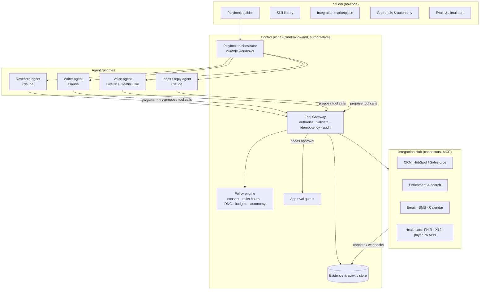

# CarePlix Agent Platform — Solution Design

**From voice agent to governed, multi-channel agents that see, validate and act on real data**
Author role: Head of Solution Design · Date: 31 Oct 2026 · Status: proposal for decision (no implementation authorised by this document)

---

## 0. Executive summary

CarePlix Voice already has the hard parts most "AI SDR" products lack:
- a real-time voice runtime on LiveKit + Gemini Live, proven on a live inbound call today;
- a control plane in which **every action is authorised on the server**;
- findings that carry **evidence and verification state**;
- immutable, versioned agent configurations.

**Recommendation.** Generalise the product into a **CarePlix Agent Platform** built from five primitives (§2):
- **Agents** — a persona plus a policy;
- **Skills** — governed capabilities;
- **Integrations** — connectors that let agents see, validate and act;
- **Channels** — voice, email, SMS and web;
- **Playbooks** — no-code, multi-step workflows.

Ship two product lines on that one platform:

| Line | First use | Why now |
|---|---|---|
| **A. Healthcare Operations agents** (current) | Prior-auth status, eligibility, scheduling, inbound enquiries | Live today. CMS-0057-F requires payer Prior Authorization FHIR APIs by **1 Jan 2027**, which makes "API first, call when the API can't answer" a defensible product. [CMS fact sheet] |
| **B. Revenue agents (AI SDR)** | CarePlix's own go-to-market first, then a customer offering | The market is crowded on email and LinkedIn; **voice is uneven and reply handling is weak** across vendors [autobound, oneai]. Voice plus governed actions is the gap. |

**The differentiator is not "more automation". It is *trustworthy* automation:**
- every claim the agent makes is checked against a system of record;
- every action is permissioned, idempotent and audited;
- every channel complies with its rules by default.

**Hard constraint:** clinical and patient data (Line A) and sales and marketing data (Line B) live in **separate tenants with separate data classes**. HIPAA restricts using PHI for marketing. The two lines share code and infrastructure, never data.

---

## 1. What we reuse (already built and proven)

| Asset | Where | Reuse for SDR and integrations |
|---|---|---|
| Voice runtime (LiveKit + Gemini Live, claim flow, tool proxies, hold and IVR states) | `apps/worker` | Speed-to-lead calls, qualification calls, inbound sales lines |
| Control plane: versioned agents, publish and rollback, privilege checks | `apps/api` | Every new skill is a versioned, publishable configuration |
| Server-side tool authorisation (`tools_service`) | `apps/api` | Becomes the **Tool Gateway** for every integration action |
| Evidence-backed findings, append-only reviewer corrections | `apps/api`, Studio Results | Research facts, qualification answers, CRM write-backs |
| Event log + SSE live timeline | `apps/api`, Studio | One timeline for email, SMS and voice touches |
| Connections with evidence-gated readiness | Studio → Connections | Integration marketplace with "verified" states |
| Invariants I1–I10 (BUILD_PLAN §1) | Platform-wide | Carry over unchanged to every channel |

---

## 2. Platform model



| Primitive | Definition | Lifecycle |
|---|---|---|
| **Agent** | Persona, voice, tone and policy references | Draft → publish → rollback (existing) |
| **Skill** | A named capability: tools + prompts + guardrails + output schema + evals (e.g. *Research account*, *Verify contact*, *Book meeting*) | Versioned; publishing checks privilege changes |
| **Integration** | A connector with a typed capability contract (§5) and tenant credentials | Connect (OAuth) → verify → per-tenant enablement |
| **Channel** | Voice in/out, email, SMS, web chat; each with compliance defaults (§7) | Route qualification (existing pattern) |
| **Playbook** | Trigger → steps (skills) → waits → branches → approvals → outcome | Built without code; compiled to an immutable, versioned workflow definition |

---

## 3. Market scan: what AI SDRs do, and where we win

Synthesised from 2026 buyer's guides and comparisons. Most are vendor-authored, so treat specific claims as indicative.

| Capability | Market status | Our position |
|---|---|---|
| Prospect research and personalisation | Universal selling point; some tools aggregate 75+ data providers [autobound] | Research **with cited evidence**: every personalisation line links to its source |
| Multichannel sequences | Email + LinkedIn common; SMS and WhatsApp in some [smartlead, knock-ai] | Email + SMS + **voice-native**; LinkedIn *assisted only* (automation breaks LinkedIn's terms) |
| Voice | **Uneven, relatively rare**; inbound qualification agents emerging (e.g. 11x Julian) [oneai, flint] | Production voice runtime with IVR, hold, DTMF, evidence and compliance gates |
| Reply handling | **Weak spot** across tools [autobound] | Reply agent with intent classification, objection handling, booking and human escalation |
| CRM sync | Table stakes [genesysgrowth] | Bi-directional with **verify-after-write** receipts and reconciliation |
| Enterprise security | SOC 2 and compliance posture are buying criteria [syncgtm] | Already designed in: audit, isolation, secrets, PHI gate |
| Pricing | ~$1k–$5k/month per platform; inconsistent [autobound] | Price per **qualified meeting / resolved task**, not per seat (doc 01 commercial measurement) |

**Where we play:** *speed-to-lead and qualification by voice*, *reply-to-meeting*, and *validated CRM actions*. Avoid competing as yet another cold-email volume engine; it's commoditised and the deliverability risk is high.

---

## 4. AI SDR skill catalogue

Every skill declares inputs, integrations, a default autonomy level (§6), guardrails, and the evidence it must produce.

| # | Skill | Integrations | Default autonomy | Evidence produced | Key guardrails |
|---|---|---|---|---|---|
| S1 | **Find accounts** (ICP match, look-alikes) | Enrichment (Apollo/ZoomInfo), CRM, web search | L2 act | ICP score + reasons + sources | Licensed data only; dedupe against CRM |
| S2 | **Research account** (news, funding, hiring, tech stack, triggers) | Web search/fetch, enrichment | L2 | Fact cards, each with URL + date | Never invent facts; stale-source flag (> 90 days) |
| S3 | **Find & verify contacts** | Enrichment, email verifier, Twilio Lookup (line type) | L2 | Verified email/phone + method | Suppression and DNC check first; mobile phone flagged for TCPA |
| S4 | **Draft outreach** (email/SMS/call script) | CRM, research cards, brand-voice knowledge | L1 draft → approve | Each personalisation line cites a fact card | Approved claims only (no pricing or clinical claims); unsubscribe footer |
| S5 | **Send email** | Gmail / Microsoft Graph (rep mailbox) | L1 until the domain is warmed, then L2 within caps | Message ID, thread ID | SPF/DKIM/DMARC verified; daily caps; one-click unsubscribe for bulk [redsift, folderly] |
| S6 | **Send SMS** | Twilio Messaging (10DLC) | L1 | Message SID, delivery status | Consent on file; STOP handling; quiet hours |
| S7 | **Call (outbound)** | LiveKit + carrier, CRM | **L1 for cold; L2 only with consent** | Transcript, disposition, findings | TCPA AI-voice consent check (§7); DNC; time windows; disclosure |
| S8 | **Speed-to-lead call** (form fill → call in under 60 s) | Web forms/CRM webhook, LiveKit | L2 (consent captured on the form) | Qualification answers (BANT/MEDDIC fields) | Consent text versioned and stored with the lead |
| S9 | **Handle reply** (classify, respond, escalate) | Mailbox, CRM | L1 → L2 for low-risk intents | Intent label + confidence + thread link | Hand legal, pricing and angry replies to a human |
| S10 | **Book meeting** | Google/Microsoft Calendar, Calendly | L2 | Calendar event ID, invite status | Verify-after-write; timezone confirmation |
| S11 | **Log & update CRM** | HubSpot/Salesforce | L2 | Activity IDs, field diffs | Field allowlist; write only to owned fields; reconcile Unknown |
| S12 | **AE handoff brief** | CRM, evidence store | L2 | Brief with linked evidence | Only verified or cited facts |
| S13 | **Inbound sales line** | LiveKit number (existing), CRM | L2 | Qualification + routing | Same verification and disclosure as Line A |

---

## 5. Integration architecture: **See → Validate → Act → Verify**

This is the core of the platform. An agent is only as useful as the data it can trust and the actions it can safely take.

### 5.1 The loop

| Stage | What happens | Platform mechanism |
|---|---|---|
| **See** | Assemble the minimum context for the task: CRM record, account facts, case data | Read tools with **field allowlists** per skill; retrieval with source, owner and effective date; tenant filters applied *before* retrieval |
| **Validate** | Cross-check what the agent heard or inferred against systems of record before relying on it | Validation tools return `confirmed / conflicting / unverifiable` → stored as finding status (existing evidence model) |
| **Act** | Propose a change; the Tool Gateway decides | Autonomy level + policy engine + approval queue; idempotency key per action; no direct connector access from models |
| **Verify** | Read back after every write | Receipt stored; mismatch → `Unknown` → reconciliation (ADR05/TR04 pattern) |

**Examples**
- *Healthcare:* the rep on the call says "approved, ref R4472". The agent validates against the payer Prior Authorization API (FHIR) or X12 278/276-277. If they differ, it marks the finding **Conflicting** and routes it to review.
- *Sales:* the prospect says "we just raised a Series B". The agent validates against enrichment and news sources, then only uses it in follow-ups if confirmed.

### 5.2 Connector contract (every integration implements this)

```
connector:
  id, version, owner, data_classes: [public | business_confidential | personal | PHI]
  auth: oauth2 | api_key | mtls          # tenant-scoped; secrets in vault, never in configs
  capabilities:
    - name: crm.contact.read             # SEE
      kind: read; fields: [allowlist]; rate_limit; cache_ttl
    - name: crm.contact.validate_email   # VALIDATE
      kind: validate; returns: confirmed|conflicting|unverifiable + source
    - name: crm.activity.create          # ACT
      kind: write; idempotency: key|natural; requires: autonomy>=L2 | approval
      verify: read_after_write           # VERIFY
      reconcile: lookup_by_external_id
  webhooks: [contact.updated, deal.stage_changed]   # signed, replay-protected
  egress: [api.hubapi.com]                          # network allowlist (SSRF control)
```

### 5.3 MCP as the connector protocol, behind our gateway

- Implement connectors as **MCP servers**, so one connector serves the voice agent, the email agent and internal Claude assistants.
- **Agents never call MCP servers directly.** Every call passes through the **Tool Gateway**, which applies tenant, skill, autonomy, consent and budget policy, then calls the MCP server with a scoped credential. This keeps SEC06 ("prompt edits cannot increase authority") true as the tool surface grows.
- Third-party MCP servers are allowed only after review, and are pinned by version and egress allowlist, the same as any other tool version (doc 04).

### 5.4 Priority connectors

| Tier | Line B (Revenue) | Line A (Healthcare) |
|---|---|---|
| **1 (first)** | HubSpot *or* Salesforce (choose one) · Google Workspace (Gmail + Calendar) or Microsoft 365 · Twilio (SMS, Lookup) · Web search/fetch | X12 270/271 eligibility and 276/277 claim status via a clearinghouse (Availity-class) · synthetic FHIR sandbox |
| **2** | Apollo or ZoomInfo enrichment · Calendly · email verification | SMART on FHIR EHR read (Epic/Oracle Health sandboxes) · payer Prior Authorization FHIR APIs as payers go live ahead of the Jan 2027 deadline [CMS] |
| **3** | Clay-style waterfall enrichment · intent data · Slack notifications | X12 278 submission · document attachment (PAS / DTR) |

---

## 6. Autonomy and governance

| Level | Name | Agent may | Typical use |
|---|---|---|---|
| **L0** | Suggest | Recommend only | New skills, new tenants |
| **L1** | Draft | Prepare the action; a human approves in the queue | First sends from a domain, cold calls, anything external-facing until proven |
| **L2** | Act within limits | Execute inside caps (volume, spend, recipients, fields) | Research, CRM logging, booking, consented calls |
| **L3** | Autonomous | Execute and report | Only after evaluation evidence and a time-boxed approval |

- **Autonomy is set per skill, per tenant, per channel.** Raising it is a privilege change that needs publisher approval (doc 04 publish transaction).
- **Policy engine checks on every action:** consent, suppression/DNC, quiet hours by recipient timezone, frequency caps, budget, data-class rules, and the kill switch (existing emergency stop extended to every channel).
- **Evals:**
  - deterministic checks (no uncited claims, correct consent, no forbidden fields);
  - simulated prospects (extend the payer simulator to a prospect simulator);
  - human review samples.
  - An LLM judge may prioritise review but never decides correctness (doc 08).

---

## 7. Compliance by channel (built into product defaults)

> These are requirements for the product to enforce, not legal advice. Legal and compliance owners confirm before any non-test outreach (OD05).

| Channel | Rule set | Product default |
|---|---|---|
| **Voice (outbound AI)** | FCC's Feb 2024 declaratory ruling: AI-generated voices are "artificial or prerecorded voice" under the TCPA, so calls need **prior express consent**, and **prior express written consent** for marketing [Kelley Drye, Wiley]. A 2024 NPRM proposed extra AI-disclosure rules; I found no confirmed final rule as of Oct 2026 [Wiley NPRM]. State mini-TCPAs; National DNC; calling hours; STIR/SHAKEN. | **No AI cold calls to mobile numbers without written consent on file.** Line-type check (Twilio Lookup) before dialling. AI disclosure at call start (already in L0 policy). Consent record (text, timestamp, source, version) stored with the contact. B2B landline calls at L1 with human approval. |
| **SMS** | TCPA consent; carrier A2P 10DLC brand/campaign registration; CTIA rules; STOP/HELP | 10DLC registration as a Connections step; consent required; automatic STOP suppression; quiet hours |
| **Email** | CAN-SPAM (US); GDPR/PECR (EU/UK); CASL (Canada, consent-based); Gmail/Yahoo/Microsoft sender rules: SPF, DKIM, DMARC, TLS, low complaint rate, one-click unsubscribe for bulk marketing; enforced by all three (Microsoft since May 2025) [redsift, folderly] | Domain authentication verified in Connections before any send; separate sending domain; per-mailbox daily caps; complaint-rate monitoring with auto-pause; geo-aware consent rules |
| **LinkedIn** | Terms prohibit automation | Assisted only: the agent drafts, a human sends |
| **Data** | Data-provider licence terms; GDPR/CCPA rights; HIPAA marketing restrictions | Licence tag on each record; deletion and DSAR flows; **no PHI in revenue tenants** |

---

## 8. Model strategy

| Job | Model | Why |
|---|---|---|
| Real-time voice | **Gemini Live native audio** on Vertex (ADR03, verified today: first audio 554 ms) | Already proven in production paths |
| Research, account strategy, AE briefs | **Claude Opus 5.5** (`claude-opus-5-5`) | Deep multi-step research with web tools and citations |
| Drafting emails, SMS, call scripts; reply handling | **Claude Sonnet 5.5** (`claude-sonnet-5-5`) | Quality writing at volume |
| Classification, routing, extraction, guard checks | **Claude Haiku 5.5** (`claude-haiku-5-5`) | Fast and cheap; schema-constrained outputs |
| Post-call result extraction (ADR17) | Claude Sonnet 5.5 *or* Gemini text | Pick by eval on our fixtures; keep the subprocessor list minimal for PHI tenants |

All model calls go through a **model gateway**:
- pinned model IDs;
- per-tenant budgets;
- prompt and response logging that follows PHI-safe rules;
- one place to swap providers after evaluation.

---

## 9. No-code Studio: how teams build skills and playbooks

| Studio surface | What a non-engineer does | What the platform guarantees |
|---|---|---|
| **Integration marketplace** | Clicks *Connect HubSpot*, completes OAuth, picks fields to expose | Credentials go to the vault; field allowlist; status is "verified" only after a live read-back test (the existing Connections pattern) |
| **Skill library** | Enables *Research account*, adjusts tone and sources, sets autonomy | Template-bounded: can't add tools or data classes the skill template doesn't allow |
| **Playbook builder** | Builds a visual flow, e.g. *Trigger: new inbound lead → Research (S2) → Verify (S3) → Speed-to-lead call (S8) → if no answer: email (S4/S5) → wait 2 days → reply handling (S9) → book (S10) → log (S11) → AE brief (S12)* | Compiled to an immutable, versioned workflow; publish shows a diff, privilege changes, affected channels and untested branches; rollback |
| **Guardrails** | Sets caps, quiet hours, approval rules, blocked claims | Enforced by the policy engine, never just by the prompt |
| **Test bench** | Runs the playbook against simulated prospects and payers, plus a Browser Test for voice | Results stored as evaluation evidence for publishing |
| **Approvals inbox** | Approves or edits L1 drafts in bulk | Edits are recorded; approved text is what gets sent (hash-checked) |
| **Results & attribution** | Sees meetings booked, cost per meeting, reply rate, and evidence per touch | Estimated vs reconciled costs labelled; no invented metrics (doc 05) |

**Workflow engine:** durable execution, with waits of days, retries and human approvals. Use a workflow engine (Temporal-class, or Google Cloud Workflows + Tasks, extending our outbox/reconciler design) rather than in-process timers.

---

## 10. Roadmap (gated, evidence-based)

| Phase | Scope | Exit evidence |
|---|---|---|
| **R0 — Finish voice D** (now) | Outbound carrier trunk; Browser Test; commit; G3 acceptance suite | T01–T12 evidence records |
| **R1 — Integration Hub foundation** | Connector contract, vault, Tool Gateway generalised, MCP adapter, model gateway; **first 3 connectors** (CRM of choice, Google/Microsoft mail + calendar, Twilio SMS + Lookup) | Live read-back tests per connector; cross-tenant isolation test |
| **R2 — Revenue pilot (internal, CarePlix's own go-to-market)** | Skills S2, S3, S4, S5 (L1), S8 speed-to-lead voice, S9 (L1), S10, S11, S12; approvals inbox; consent ledger | 30-day internal pilot: meetings booked, reply rate, zero compliance exceptions, deliverability within thresholds |
| **R3 — No-code Playbooks** | Visual builder, test bench, simulators for prospects, analytics | A second team builds and publishes a playbook without engineering help |
| **R4 — Healthcare data integrations** | X12 270/271 and 276/277 via clearinghouse; FHIR sandbox; validation of call findings against electronic status | Conflicting-finding detection demonstrated on synthetic cases; PHI gate (G4) passed before real data |
| **R5 — Customer offering** | Multi-tenant provisioning, BYO provider credentials, billing per outcome, SOC 2 programme | External design partner live |

Line A's G4 PHI gate and Line B's R2 pilot can run in parallel because they share no data.

---

## 11. Decisions needed

1. **Who is the first SDR customer?** I recommend **CarePlix's own go-to-market** (selling to providers, payers or employers), so we prove value internally before selling it.
2. **CRM of record:** HubSpot or Salesforce.
3. **Sending domain and mailboxes** for outreach (separate from the corporate domain).
4. **Voice outreach risk appetite:** consented and inbound-led only (recommended), or approved B2B landline cold calls at L1.
5. **Enrichment provider and licence:** Apollo or ZoomInfo, and whether we use web research only at first.
6. **Clearinghouse partner** for the X12 eligibility and claim-status connectors (Line A).
7. **Workflow engine:** Temporal-class or Google Cloud Workflows.

## 12. Top risks and mitigations

| Risk | Mitigation |
|---|---|
| TCPA exposure from AI voice | Consent ledger + line-type check + L1 default for cold calls; counsel review (§7) |
| Domain reputation damage | Separate domain, warm-up, caps, complaint-rate auto-pause |
| Hallucinated personalisation | Citation-required drafting; deterministic "no uncited claim" check |
| Integration side effects (duplicate writes) | Idempotency + verify-after-write + reconciliation (existing patterns) |
| PHI leaking into sales tooling | Separate tenants, data-class tags, gateway-enforced boundaries |
| Scope creep into commodity cold email | Lead with voice, reply-to-meeting and validated CRM actions |

---

### Sources

- CMS Interoperability & Prior Authorization Final Rule (CMS-0057-F) fact sheet — https://www.cms.gov/newsroom/fact-sheets/cms-interoperability-and-prior-authorization-final-rule-cms-0057-f
- Health Samurai, CMS-0057-F overview — https://www.health-samurai.io/articles/understanding-the-cms-0057-f-interoperability-and-prior-authorization-final-rule
- Kelley Drye, FCC declares TCPA restrictions apply to AI-generated calls — https://www.kelleydrye.com/viewpoints/blogs/ad-law-access/fcc-declares-tcpa-restrictions-apply-to-ai-generated-calls
- Wiley, FCC extends TCPA restrictions to AI-generated voices — https://wiley.law/alert-FCC-Extends-Regulatory-Reach-Over-AI-Announces-TCPA-Restrictions-Cover-AI-Generated-Voices-in-Outbound-Calls
- Wiley, FCC proposes new rules for AI-generated calls and texts — https://wiley.law/alert-FCC-Proposes-New-Rules-for-AI-Generated-Calls-and-Texts
- Red Sift, bulk email sender requirements — https://redsift.com/guides/bulk-email-sender-requirements
- Folderly, Gmail/Yahoo/Outlook sender requirements 2026 — https://generate.folderly.com/blog/gmail-yahoo-outlook-sender-requirements-2026
- Autobound, AI SDR tools buyer's guide (2026) — https://autobound.ai/blog/ai-sdr-tools-buyers-guide
- OneAI, AI SDR tools comparison — https://oneai.com/learn/ai-sdr-tools-comparison
- Flint, AI SDR tools — https://www.flint.com/blog/ai-sdr-tools
- Smartlead, multi-channel outreach platforms 2026 — https://www.smartlead.ai/blog/multi-channel-outreach-tools
- Knock AI, best AI SDR tools 2026 — https://www.knock-ai.com/blog/ai-sdr-tools
- Genesys Growth, AI SDR platforms compared — https://genesysgrowth.com/blog/ai-sdr-platforms-compared
- SyncGTM, best AI SDR tools 2026 — https://syncgtm.com/blog/best-ai-sdr-tools-2026
