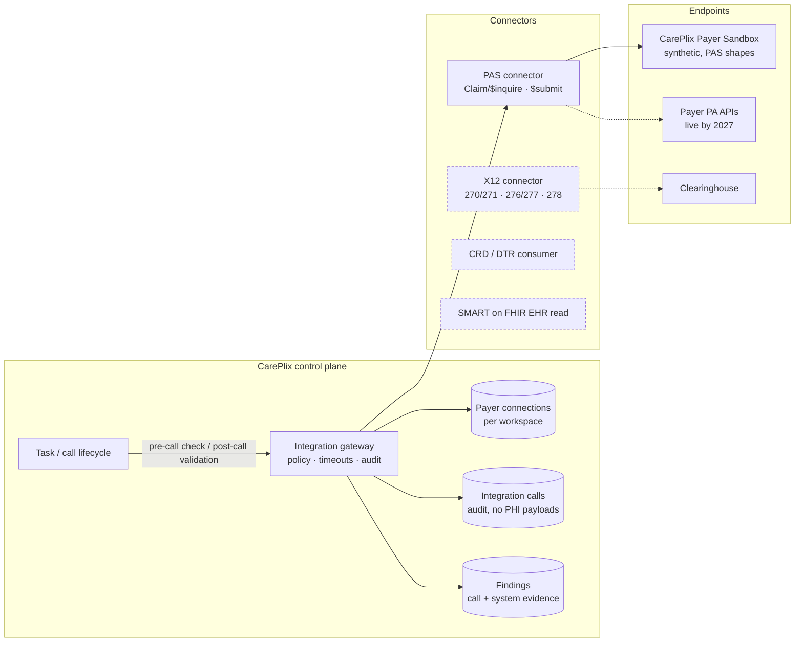

# Healthcare Integration Layer — Design

**Scope:** healthcare automation only. How CarePlix agents **see, validate and act** on payer and provider data, aligned with the CMS Interoperability & Prior Authorization rule (CMS-0057-F) and the HL7 Da Vinci implementation guides.
**Status:** first slice built in this repository (§6). Everything else is staged in §7. Synthetic data only until the G4 PHI gate.

---

## 1. Why this layer matters

A voice call gives *reported* facts ("pending, ref 73915"). CMS-0057-F requires impacted payers to expose a **Prior Authorization API** by **1 January 2027**, supporting electronic requests, responses, status updates and documentation exchange over FHIR [CMS]. That changes the product:

> **API first, call when the API can't answer, and validate every call against the API.**

| Today (voice only) | With the integration layer |
|---|---|
| Call the payer to learn the status | Check status electronically first; call only for what the API can't answer (missing documents, clarifications, payers not yet live) |
| A finding is *Reported* or *Confirmed on call* | A finding is also **System verified**, or **Conflicting** with the payer's system → automatic review |
| Reviewers check transcripts by hand | Reviewers see call finding vs payer record side by side |

---

## 2. The CMS / Da Vinci landscape we build against

| Standard | Purpose | Who hosts it | Status for us |
|---|---|---|---|
| **Da Vinci PAS** (Prior Authorization Support) | `Claim/$submit` (request) and `Claim/$inquire` (status) as FHIR Bundles; payers answer synchronously, target ≤ 15 s [PAS IG, CapMinds] | Payer (or intermediary) | **Built now:** client connector + CarePlix Payer Sandbox |
| **Da Vinci CRD** (Coverage Requirements Discovery) | Is prior auth required, and what documentation? Delivered via CDS Hooks at order time | Payer, called from the EHR | Stage 2: our agent consumes CRD responses to pre-check requirements |
| **Da Vinci DTR** (Documentation Templates and Rules) | Questionnaires + rules to collect the required documentation | Payer rules, run in a SMART app or EHR | Stage 3: agent pre-fills DTR from the EHR, then a human signs |
| **X12 270/271, 276/277, 278** | Eligibility, claim status and prior auth over legacy EDI, often via a clearinghouse | Clearinghouse (Availity-class) | Stage 2: covers payers without FHIR APIs |
| **SMART on FHIR / Backend Services** | Authorisation for EHR reads and system-to-system calls | EHR / payer | Backend Services (signed JWT client assertion) supported in the client design |
| **CMS Blue Button 2.0 / DPC** | Medicare claims data: patient-authorised (BB2) or provider (DPC); synthetic sandboxes exist [Blue Button] | CMS | Optional context source; not on the prior-auth critical path |

**Versions.** Sources cite PAS/CRD/DTR **STU 2.0.1** and **2.2.x**. CMS-0057-F *recommends* these guides, and the proposed **CMS-0062-P** would require them (reported date 1 Oct 2027, still a proposal) [Health Samurai, Mindbowser]. The connector is **version-tagged** so several versions can run side by side (baseline plus the previous version).

**Conformance.** No free public PAS server exists. The **Inferno PAS test kit** can simulate a payer to test a client, or test a server [Inferno]. We'll run it against our client and our sandbox once Docker is available. Until then, mappings in this repo are **aligned to the PAS STU 2 resource shapes, not certified**.

---

## 3. Architecture

**Rules**
- **Only the control plane calls connectors.** The voice model never gets a raw payer client. Validation runs as a deterministic workflow step (§5). If later exposed as an agent tool, it goes through the same server-side authorisation (SEC06).
- **Connections are per workspace:** base URL, auth type, IG version, and payer-to-endpoint mapping. Secrets are **references** (environment or secret-manager names), never stored values.
- **Each connection must prove itself before use:** a connection is *verified* only after a live CapabilityStatement read plus a test operation (the same evidence pattern as Connections).
- **Every external call is audited** with connection, operation, duration, outcome and a request hash. Payloads containing patient data are **not** logged (SEC08).
- **Idempotency:** `$submit` carries our deterministic Claim identifier. A timeout leaves the result *Unknown*, and the next step is `$inquire`, never a blind resubmit (TR04).

---

## 4. PAS mapping (STU 2 shapes)

**`$inquire` request:** a Bundle (`collection`) containing:
- **Claim:** `use = preauthorization`, `status = active`, our tracking `identifier`, `patient`, `provider`, `insurer`, `item.productOrService` (CPT), `item.servicedDate`;
- **Patient:** member identifier, name, birth date;
- **Organization:** insurer, and the requesting provider with its NPI.

**Response:** a Bundle containing a **ClaimResponse** with `outcome`, `preAuthRef`, and per item an adjudication carrying the **review action** extension (`extension-reviewAction`), coded with the X12 306 action codes.

| PAS / X12 306 review action | Meaning | CarePlix `reported_status` |
|---|---|---|
| A1 | Certified in total | `approved` |
| A2 | Certified, partial | `approved` (partial noted) |
| A3 | Not certified | `denied` |
| A4 | Pended | `pending_review`, or `pending_additional_information` when the reason asks for documentation |
| A6 | Modified | `approved` (modified noted) |
| C / CT / D | Cancelled / contact payer / deferred | `unknown` → call needed |
| No ClaimResponse found | — | `not_found` |

---

## 5. End-to-end healthcare flows

**Outbound prior-auth status (the first workflow):**
1. **Task created** → the gateway runs **PAS `$inquire`** for the case's payer.
   - If the result is final and complete (approved or denied with a reference), the task is flagged *Electronic answer available*. An operator can close it without a call.
   - If the result is pended or not live → place the call, with the electronic result shown in the call brief context. (Planned; the current slice records it on the task and in Results.)
2. **The call** runs as today. The agent records findings with transcript evidence.
3. **Call ends** → the gateway runs `$inquire` again and **compares**:
   - match → the finding gains **System verified** evidence;
   - mismatch → both are marked **Conflicting** and the task needs review;
   - fields the API can't provide (missing-document date range, rep name, call reference) stay call-evidenced.

**Inbound enquiry (later):** after `verify_caller`, the agent may read the electronic status through a server-authorised tool and disclose only allowlisted fields.

**Submission (Stage 3, L1 approval):** case + DTR-collected documentation → `$submit`, approved by a human → receipt → `$inquire` to verify.

---

## 6. What is built now (this repository)

| Piece | Location | Notes |
|---|---|---|
| Connector framework: capability kinds (read / validate / act), results, audit | `apps/api/src/careplix_api/integrations/` | Shared by future X12, CRD and EHR connectors |
| FHIR client: no-auth sandbox, or SMART Backend Services (signed JWT client assertion) | `integrations/fhir.py` | Secrets resolved from environment references |
| **PAS connector:** build `$inquire` Bundle, parse ClaimResponse, map review actions | `integrations/pas.py` | Version-tagged `pas-stu2` |
| **CarePlix Payer Sandbox:** FHIR `metadata`, `Claim/$inquire`, `Claim/$submit` on synthetic payers | `apps/payer_sandbox/` | Answers from `fixtures/synthetic`; every response is tagged synthetic |
| Payer connections + verification + integration call audit | API + Studio → **Integrations** | Payer-to-connection mapping per workspace |
| Pre-call electronic check and post-call validation | Task creation / call finalisation | Adds `system_verified` / `conflicting` finding states |
| Results: call finding vs payer record | Studio Results | Evidence linked to the integration call |

## 7. Next stages

| Stage | Scope | Exit evidence |
|---|---|---|
| **H1 (this slice)** | PAS `$inquire` client, sandbox, pre/post-call validation, Studio Integrations | Tests green; sandbox round-trip in the Studio |
| **H2** | Inferno PAS client and server suites in CI (Docker); clearinghouse X12 276/277 + 270/271 connector; brief enrichment with the electronic status | Inferno pass reports stored as evidence |
| **H3** | `$submit` with L1 approval; DTR questionnaire pre-fill from the EHR (SMART on FHIR sandbox); CRD requirement pre-check | Human-approved synthetic submission round-trip |
| **H4** | First real payer endpoint or intermediary under BAA; PHI gate G4 | Executed agreements, endpoint review, monitored pilot |

## 8. Decisions needed

1. Target PAS version for production: 2.0.1 baseline + 2.2.x, or 2.2.x only.
2. Clearinghouse partner for X12, which most payers will still use in 2027.
3. Which EHR sandbox to integrate first (Epic, Oracle Health, athenahealth).
4. Whether a final electronic determination may close a task without a call (an auto-close policy), or always needs a reviewer.

### Sources
- CMS-0057-F fact sheet — https://www.cms.gov/newsroom/fact-sheets/cms-interoperability-and-prior-authorization-final-rule-cms-0057-f
- Da Vinci PAS IG — https://build.fhir.org/ig/HL7/davinci-pas/specification.html
- Inferno Da Vinci PAS test kit — https://github.com/inferno-framework/davinci-pas-test-kit/wiki/Client-Instructions-v2.2.1
- 1upHealth PAS docs — https://docs.1up.health/docs/epa/pas
- CapMinds, CRD/DTR/PAS architecture pack — https://www.capminds.com/blog/fhir-prior-authorization-architecture-pack-crd-dtr-pas-sequence-diagrams-and-readiness-checklist/
- Mindbowser, CMS-0062-P — https://www.mindbowser.com/cms-0062-p-fhir-ig-mandates-custom-ehrs/
- Health Samurai, CMS-0057-F — https://www.health-samurai.io/articles/understanding-the-cms-0057-f-interoperability-and-prior-authorization-final-rule
- CMS Blue Button developers — https://bluebutton.cms.gov/developers
