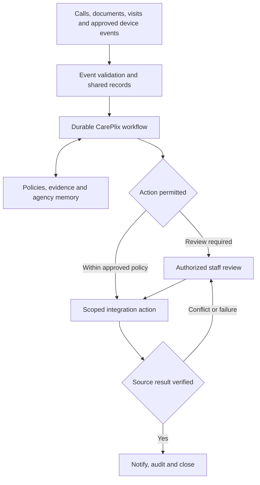

# CarePlix Home Agency Feature Map and Automation Blueprint

**Phoebe and Sage Care research, detailed workflows, and a proposed end-to-end platform**

Prepared for Abhisek Sengupta and CarePlix Healthcare  
Research date: November 16, 2026  
Version: 1.0 — product planning document, before implementation

**Navigation:** [Scope](#1-purpose-and-recommended-direction) · [Phoebe features](#3-phoebe-detailed-public-feature-inventory) · [Sage features](#4-sage-care-detailed-public-feature-inventory) · [Agency lifecycle](#6-full-agency-lifecycle-and-automation-ownership) · [Detailed workflows](#7-detailed-proposed-working-of-the-major-workflows) · [Advanced features](#8-advanced-capabilities-to-build-beyond-baseline-parity) · [CarePlix reuse](#9-careplix-products-and-services-to-reuse) · [Architecture](#10-build-buy-and-integration-architecture) · [Roadmap](#14-build-sequence-and-release-gates) · [Sources](#18-source-register)

## 1. Purpose and recommended direction

Build a CarePlix platform that connects agency growth, intake, assessment, staffing, visits, documentation, family communication, revenue operations, and quality management. Start by completing two measurable workflows: **inquiry to approved care plan** and **caregiver call-out to confirmed replacement**. Add connected-care capabilities after the operational foundation is reliable.

Phoebe and Sage are now part of the same company. Both companies announced Phoebe's acquisition of Sage on November 2, 2026. Phoebe described expansion from scheduling into intake, assessments, care planning, and client management. This supports a combined product direction; it does not establish that every function already operates in one integrated release. [P20][S06]

The proposed working product name is **CarePlix Home Operations**, powered by HealthWeave and Semantic OS. This name is a planning label, not a branding or trademark clearance.

### What this document establishes

- A granular inventory of publicly documented Phoebe and Sage capabilities.
- The distinction between current marketing claims, dated releases, beta announcements, and waitlisted functionality.
- How to implement the corresponding workflows, including exceptions and human decisions.
- Additional advanced features that could automate the full agency lifecycle.
- A build-versus-integrate plan using existing CarePlix assets and external infrastructure.
- A phased delivery plan, proposed acceptance tests, and commercial assumptions.

### Evidence and completeness

This is a comprehensive map of the public pages, release notes, integration pages, and mobile listing reviewed. It is not a claim to have inspected every setting in either paid product. No customer account, private demo, source repository, signed vendor agreement, or production integration was examined.

**Evidence labels**

| Label | Meaning |
|---|---|
| Marketed | The current public site describes the capability; production behavior was not independently tested. |
| Released | A dated vendor update describes a shipped feature. Tenant availability still needs confirmation. |
| Historical beta | The cited announcement called it beta or preview; do not assume universal availability today. |
| Waitlist | The relevant product page currently asks users to join a waitlist. |
| Proposal | Our recommended design; not a claim about either competitor. |
| Unverified | The reviewed material does not establish the capability, entitlement, or implementation detail. |

When a later page describes a capability more broadly than an earlier beta, both facts are retained. Product-specific APIs, field permissions, concurrency, and contract terms must be validated with the vendor.

### Home care and home health require different workflows

| Business type | Primary operating model | Platform implications |
|---|---|---|
| Non-medical private-pay home care | Personal assistance, companionship, activities of daily living, hourly services | Intake, service agreements, caregiver matching, attendance, notes, billing, and family updates. |
| Medicaid personal care | Authorized personal-care services with state/payer requirements | Add authorization units, applicable EVV, payer-specific submissions, and exception reconciliation. |
| Skilled home health | Nursing and therapy under an authorized clinical plan | Add orders, clinician assessments, applicable OASIS, certification, clinical documentation, payer rules, and quality reporting. |
| Senior living or assisted living | Facility operations with resident-specific services | Add facility permissions, staffing patterns, escalation ownership, and location-specific policies. |

The initial launch recommendation is US non-medical home care. Skilled home health should be a separately validated product track. CMS describes Medicare home-health eligibility and practitioner certification requirements; these cannot be reduced to an AI-generated intake score. [R01]

## 2. What the two products cover

| Dimension | Phoebe | Sage Care | CarePlix opportunity |
|---|---|---|---|
| Primary focus | Scheduling and agency operations | Intake and client communications | One workflow spanning acquisition through ongoing service |
| Main interactions | Calls, SMS, scheduler conversations | Calls, assessment recordings, follow-up emails | Shared communication history with consent and permissions |
| Staffing | Matching, outreach, assignments, confirmations | Care needs and matching criteria captured during intake | Carry approved needs directly into scheduling constraints |
| Documentation | Operational notes, call summaries, scheduling updates | Assessment summaries and draft care plans | Evidence-linked documentation with review and version history |
| Field interface | Caregiver communication; separate assistant waitlist | Native iPhone application and web interface | Caregiver and clinician tools designed for field conditions |
| Integration | Many named agency systems; connector depth varies | Dedicated WellSky and AxisCare integration pages | Measured read/write support per field and workflow |
| Monitoring | No complete connected-device operating layer established in reviewed material | No complete connected-device operating layer established | Validated CarePlix device events connected to accountable follow-up |
| Full agency replacement | Not established | Not established | Begin as an automation layer over existing systems of record |

Phoebe's November 2 acquisition announcement reports more than 900 agencies. This is a vendor-reported figure, not an independently verified customer count or performance guarantee. [P20]

Sage provides personalized pricing through a demo. A fixed current subscription price for either product was not established in this review. Phoebe advertises month-to-month terms. [S01][P01]

## 3. Phoebe detailed public feature inventory

The descriptions below are deliberately compact public feature mappings. Section 7 gives the detailed recommended implementation, without pretending to know Phoebe's private backend.

### 3.1 Core operating roles

| ID | Feature | Publicly described working | Evidence |
|---|---|---|---|
| P-F01 | Receptionist | Receives calls, recognizes operational needs, and escalates exceptions. | Marketed [P01] |
| P-F02 | Scheduler | Contacts suitable caregivers and completes staffing coordination. | Marketed [P01] |
| P-F03 | Timekeeper | Follows up on missing attendance records. | Marketed [P01] |
| P-F04 | Agency memory | Retains caregiver, client, and operating preferences. | Marketed [P01] |
| P-F05 | Caregiver engagement | Refreshes availability and re-engages inactive roster members. | Marketed [P01] |
| P-F06 | Advance confirmations | Checks attendance intentions before upcoming shifts. | Marketed [P01] |

### 3.2 Open-shift detection and coordination

| ID | Feature | Publicly described working | Evidence |
|---|---|---|---|
| P-F07 | Automatic open-shift detection | Monitors schedule gaps and declined shifts, then starts outreach preparation. | Released/rollout [P05] |
| P-F08 | Context assembly | Combines client information, care plans, agency rules, and prior interactions. | Released/rollout [P05] |
| P-F09 | Explained caregiver shortlist | Presents recommended caregivers with individual selection reasons. | Released/rollout [P05] |
| P-F10 | Grouped outreach | Combines related shifts to reduce repeated caregiver messages. | Released/rollout [P05] |
| P-F11 | Scheduler coaching | Incorporates organizational instructions and staff feedback into subsequent work. | Released/rollout [P05] |
| P-F12 | Incoming caregiver calls | Handles replies and transfers calls to the relevant office. | Released/rollout [P05] |
| P-F13 | Browser sidebar | Lets staff manage outreach and approvals alongside their existing applications. | Released/rollout [P05] |
| P-F14 | Desktop notifications | Alerts staff to caregiver responses outside the main product tab. | Released/rollout [P05] |

### 3.3 Writes to the agency scheduling system

| ID | Feature | Publicly described working | Evidence |
|---|---|---|---|
| P-F15 | Shift creation | Creates individual visits or recurring schedules. | Released [P02] |
| P-F16 | Assignment changes | Assigns, removes, or replaces caregivers. | Released [P02] |
| P-F17 | Schedule edits | Changes dates, times, or a recurring series. | Released [P02] |
| P-F18 | Rate changes | Updates supported shift and care-log rates. | Released [P02] |
| P-F19 | Cancellation and deletion | Cancels with a reason or deletes a shift. | Released [P02] |
| P-F20 | Availability updates | Saves caregiver schedule preferences learned through communication. | Released [P02] |
| P-F21 | Clock entry and correction | Records or adjusts attendance times from caregiver requests. | Released [P02] |
| P-F22 | Late-arrival context | Adds lateness reasons and revised arrival information. | Released [P02] |
| P-F23 | Operational notes | Writes supported notes, memos, tags, and modification reasons. | Released [P02] |
| P-F24 | Office-call documentation | Transcribes staff conversations and files summaries with recording references. | Released [P02] |

These are vendor-described operations, not a recommendation to grant identical permissions automatically. Rate edits, deletion, attendance correction, and recurring changes need explicit CarePlix policies.

### 3.4 Client notifications and assignment controls

| ID | Feature | Publicly described working | Evidence |
|---|---|---|---|
| P-F25 | Client assignment notification | Calls the client after a caregiver is assigned. | Released [P03] |
| P-F26 | Alternate contact | Routes notification to a configured secondary contact. | Released [P03] |
| P-F27 | Notification preferences | Supports quiet hours and client-specific suppression. | Released [P03] |
| P-F28 | Editable care summaries | Staff can revise client-level or outreach-specific summaries. | Released [P03] |
| P-F29 | Additional contact attempts | Adds voice or SMS steps to ongoing outreach. | Released [P03] |
| P-F30 | Draft-first automation | Generates pending outreach for staff review. | Released [P03] |
| P-F31 | Assignment policy controls | Configures automatic assignment by organization, outreach, shift, or group. | Released [P03] |
| P-F32 | Record activity history | Shows who changed clients, caregivers, shifts, and outreaches. | Released [P03] |
| P-F33 | Mobile-friendly interface | Supports reviewing messages and managing outreach on smaller screens. | Released [P03] |

### 3.5 Outreach configuration and operational visibility

| ID | Feature | Publicly described working | Evidence |
|---|---|---|---|
| P-F34 | Editable contact sequences | Configures SMS, calls, and delays for different outreach types. | Released [P04] |
| P-F35 | Central call history | Filters inbound/outbound logs and opens call details. | Released [P04] |
| P-F36 | Recent inbound-call feed | Surfaces recent incoming calls on the home screen. | Released [P04] |
| P-F37 | Multi-shift group editor | Groups related visits and reuses caregiver selections. | Released [P04] |
| P-F38 | Review indicators | Flags multi-shift interactions needing coordinator attention. | Released [P04] |
| P-F39 | Multi-shift care summaries | Sends relevant care information for the shifts a caregiver selects. | Released [P06] |
| P-F40 | Client exclusion lists | Excludes selected clients from reminders or confirmations. | Released [P06] |
| P-F41 | Ambiguous-reply handling | Marks conditional acceptance or proposed time changes for review. | Released [P06] |
| P-F42 | Message variables | Inserts relative dates, weekdays, and available distance information. | Released [P06] |
| P-F43 | Editable closing messages | Customizes assignment and filled-shift communications. | Released [P06] |
| P-F44 | Direct record navigation | Displays client phone details and links to agency records. | Released [P06] |
| P-F45 | Geographic filtering | Includes caregiver cities in selection and filtering. | Released [P06] |
| P-F46 | Message attribution | Distinguishes staff-sent messages from AI messages. | Released [P06] |
| P-F47 | Saved date navigation | Preserves shift-date selection and offers a today shortcut. | Released [P06] |

### 3.6 Matching, agency ownership, and language

| ID | Feature | Publicly described working | Evidence |
|---|---|---|---|
| P-F48 | Matching inputs | Considers distance, prior client visits, schedules, overtime, language, and stated preferences. | Historical beta; later broader matching marketed [P07][P05] |
| P-F49 | Availability memory | Uses previously communicated restrictions when recommending caregivers. | Historical beta; later memory marketed [P07][P01] |
| P-F50 | Cancellation communication | Supports internal explanations and configurable caregiver notifications. | Released [P07] |
| P-F51 | Location and template defaults | Supports ZIP information and editable prefilled communication templates. | Released [P07] |
| P-F52 | Coordinator-specific views | Syncs coordinator assignments and filters relevant work. | Released [P08] |
| P-F53 | Coordinator notification routing | Directs updates to the assigned coordinator. | Released [P08] |
| P-F54 | Deferral of on-shift calls | Can postpone voice outreach until after a caregiver's current shift. | Released [P08] |
| P-F55 | Preferred-language communication | Uses caregiver language information for calls and messages where supported. | Released [P09] |
| P-F56 | After-hours reply policies | Configures responses to declines and uncertain replies outside office hours. | Released [P09] |

The January matching announcement also lists gender. This is a description of its public material, not a recommended general employment-ranking rule. CarePlix should validate any sensitive matching criterion against legitimate care requirements and applicable employment rules.

### 3.7 Controls, attendance, and earlier released improvements

| ID | Feature | Publicly described working | Evidence |
|---|---|---|---|
| P-F57 | Pause and resume | Stops an outreach sequence and later continues it. | Released [P10] |
| P-F58 | Message reactions | Interprets supported tapback reactions in conversation context. | Released [P10] |
| P-F59 | In-product support chat | Connects agency users with the vendor support team. | Released [P10] |
| P-F60 | Default caregiver pay rates | Applies the supported profile rate during assignment. | Released [P11] |
| P-F61 | Authorization checks | Respects active WellSky authorizations during assignment. | Released [P11] |
| P-F62 | Overtime alerts | Surfaces WellSky overtime warnings before assignment. | Released [P11] |
| P-F63 | Parallel calling | A December 2025 update reported 60 simultaneous calls; current limits need confirmation. | Historical capacity statement [P11] |
| P-F64 | Recurring-shift offers | Presents recurring schedules during outreach. | Released [P12] |
| P-F65 | Consolidated conversations | Combines confirmation and open-shift messages in one view. | Released [P13] |
| P-F66 | Conversation navigation | Provides unread status, longer-history navigation, and notification dismissal. | Released [P13] |
| P-F67 | Conversational scheduler commands | A preview described requests to find staff, update records, and launch outreach. | Historical preview [P13] |
| P-F68 | Voice customization | Earlier voice-pipeline announcements described voice options and cloning. | Historical beta; verify present entitlement [P14] |
| P-F69 | Candidate-list expansion | Adds caregivers after outreach starts and imports supported tags/address information. | Released [P14] |
| P-F70 | Human messaging controls | Lets staff edit AI drafts and directly message caregivers. | Released [P15] |
| P-F71 | Email alerts | Notifies subscribed staff of selected acceptance/decline events. | Released [P15] |
| P-F72 | Consolidated daily confirmation | Combines a caregiver's same-day shifts into one confirmation text. | Released [P15] |
| P-F73 | Test/live separation | Separates test records from operational shift and caregiver data. | Released [P16] |
| P-F74 | Preview calls | Calls a tester before a caregiver campaign launches. | Released [P16] |
| P-F75 | Table and tag filters | Sorts and filters shift/caregiver information and imported agency tags. | Released [P16] |
| P-F76 | Feedback on drafted messages | Collects ratings and comments to improve subsequent communication. | Released [P17] |
| P-F77 | Manual confirmation status | Allows staff to update confirmation status without another outgoing message. | Released [P17] |
| P-F78 | Attendance reminders by connector | Announced reminders for AxisCare/HHAeXchange and clock-write processing for WellSky. | Historical beta [P18][P17] |
| P-F79 | Caregiver record links | Opens source caregiver records from outreach responses. | Released [P18] |

### 3.8 Separate caregiver assistant

| ID | Feature | Publicly described working | Evidence |
|---|---|---|---|
| P-F80 | Shift finding | Personal assistant proposes suitable work opportunities. | Waitlist [P19] |
| P-F81 | Route planning | Advertised assistance with routes. | Waitlist [P19] |
| P-F82 | License-renewal assistance | Advertised help with licensing administration. | Waitlist [P19] |
| P-F83 | Dictated OASIS notes | Advertised voice documentation assistance. | Waitlist [P19] |
| P-F84 | Caregiver administrative tasks | Advertised messaging, paperwork, and pre-visit calls. | Waitlist [P19] |

### 3.9 Named integrations and commercial claims

The homepage names WellSky, AxisCare, HHAeXchange, Homecare Homebase, CareSmartz360, KanTime, Alora, Generations, MatrixCare, eRSP, SwyftOps, Axxess, AlayaCare, and Aaniie. It also names several telephone and team-chat systems. A named logo does not establish read/write parity or a supported public API. [P01]

The strongest detailed write-back evidence in the reviewed releases concerns WellSky and AxisCare. HHAeXchange has dated beta announcements. Treat every other connector as a separate diligence item. [P02][P11][P12]

Phoebe states HIPAA compliance and says SOC 2 is in progress on its homepage. This review did not inspect its restricted audit evidence. [P01]

Its public engineering article describes independently scaling voice workers, separation from business/database logic, and enforced code boundaries. That is useful architecture evidence, not a complete technology-stack disclosure. [P21]

## 4. Sage Care detailed public feature inventory

### 4.1 Reception and lead capture

| ID | Feature | Publicly described working | Evidence |
|---|---|---|---|
| S-F01 | AI receptionist | Answers incoming agency calls around the clock. | Marketed [S02] |
| S-F02 | Existing-number forwarding | Routes an agency's current telephone traffic to the assistant. | Marketed [S02] |
| S-F03 | Caller-purpose classification | Separates prospects, active clients, and caregiver needs. | Marketed [S02] |
| S-F04 | Structured initial intake | Captures service needs, timing, and payment-related information. | Marketed [S02] |
| S-F05 | Human routing | Transfers calls requiring the appropriate team member. | Marketed [S02] |
| S-F06 | Routine question handling | Answers configured agency questions and records the interaction. | Marketed [S02] |
| S-F07 | Call summary synchronization | Files call outcomes in connected agency systems. | Marketed [S02] |

### 4.2 Assessment, documentation, and CRM

| ID | Feature | Publicly described working | Evidence |
|---|---|---|---|
| S-F08 | Intake-call recording | Captures conversations for documentation. | Marketed [S03] |
| S-F09 | In-home assessment recording | Records assessments on the user's iOS device. | Marketed [S03] |
| S-F10 | Ongoing-visit recording | Uses later visit conversations to inform updated documentation. | Marketed [S03] |
| S-F11 | Transcription and translation | Converts speech to text and supports translated summaries. | Marketed [S03] |
| S-F12 | Structured information extraction | Organizes needs, schedules, and contact details from conversations. | Marketed [S03] |
| S-F13 | Draft care plans | Generates documentation for staff review and editing. | Marketed [S03] |
| S-F14 | Continuing plan updates | Uses subsequent interactions to refresh proposed care information. | Marketed [S03] |
| S-F15 | Follow-up email drafting | Prepares personalized recaps and next steps. | Marketed [S03] |
| S-F16 | Prospect pipeline | Tracks prospects through conversion, with related activity and records. | Marketed [S03] |
| S-F17 | Review-and-approve workflow | Surfaces generated actions before staff approval. | Marketed [S01] |

### 4.3 Native mobile and communication tools

| ID | Feature | Publicly described working | Evidence |
|---|---|---|---|
| S-F18 | iPhone VoIP calling | Places and receives agency-number calls from the mobile app. | App listing [S04] |
| S-F19 | Voicemail and missed-call management | Provides voicemail transcription and callback workflows. | App listing [S04] |
| S-F20 | Unified contact directory | Maintains client/contact histories and search. | App listing [S04] |
| S-F21 | Referrer management | Handles referring people and institutions with agency-system synchronization. | App release notes [S04] |
| S-F22 | Email referrals and sending | Supports referral emails and sending emails from the app. | App release notes [S04] |
| S-F23 | Mobile alerts and call keypad | Supports push notifications and IVR keypad interactions. | App release notes [S04] |
| S-F24 | Duplicate prevention | Addresses duplicate prospects, clients, contacts, and referrers. | App release notes [S04] |
| S-F25 | Attachments and multiple numbers | Supports follow-up attachments and multiple phone numbers. | App release notes [S04] |
| S-F26 | Post-call action conflict handling | Release history describes improvements to conflicting post-call actions. | App release notes [S04] |

### 4.4 Integration fields and operator tools

| ID | Feature | Publicly described working | Evidence |
|---|---|---|---|
| S-F27 | AxisCare client synchronization | Reads/writes client contact information, demographics, and relationships. | Dedicated integration page [S05] |
| S-F28 | AxisCare contact synchronization | Synchronizes related contacts and communication records. | Dedicated integration page [S05] |
| S-F29 | AxisCare care-plan synchronization | Transfers needs, matching criteria, conditions, and ADL/IADL information. | Dedicated integration page [S05] |
| S-F30 | WellSky Personal Care synchronization | Describes bidirectional client, contact, and care-plan fields. | Dedicated integration page [S07] |
| S-F31 | Web and mobile access | Provides desktop review alongside mobile operation. | Marketed [S01] |
| S-F32 | Telephone-system flexibility | Describes its own VoIP offering and coexistence with existing systems. | Marketed [S01] |
| S-F33 | Guided onboarding and support | Configures agency workflows and supports staff adoption. | Marketed [S01] |
| S-F34 | HomeCareGPT care-plan drafting | A separate tool transforms entered notes into proposed care documentation. | Announcement [S08] |
| S-F35 | HomeCareGPT correspondence | Drafts family/referral communications from supplied context. | Announcement [S08] |
| S-F36 | HomeCareGPT matching summaries | Produces caregiver-requirement summaries from client information. | Announcement [S08] |
| S-F37 | HomeCareGPT visit-note standardization | Organizes shift information into more consistent documentation. | Announcement [S08] |

Sage's older FAQ blocks sometimes describe AxisCare as forthcoming, while its dedicated AxisCare page and mobile release history describe integration. Prefer the more specific evidence, but confirm current account availability. Additional systems mentioned as available upon request should not be advertised as equivalent supported connectors. [S01][S04][S05][S07]

The public HomeCareGPT announcement describes a free offering. Its current service availability, PHI terms, and post-acquisition roadmap were not independently tested. Sage's security language is vendor-provided; this review did not audit its implementation. [S08][S01]

## 5. How the competitor workflows fit together

### Phoebe scheduling pattern

The public pattern is: identify an uncovered visit, assemble context, choose caregivers, conduct outreach, resolve responses, make a permitted assignment, and notify affected people. The approved scheduling-system update is the operational result. A conversation alone does not complete the job. [P05]

### Sage intake pattern

The public pattern is: capture an inquiry or assessment, extract information, prepare documentation and follow-up, obtain staff review, and synchronize records. Later recorded interactions can feed further documentation updates. [S03]

### Proposed CarePlix connection

Approved intake information should become executable staffing requirements. A service plan specifying transfer assistance, a time window, language support, and an authorized number of hours should directly inform matching. Subsequent visit observations should trigger review of the same plan, preserving the original evidence and approvals.

This is our design recommendation. The acquisition announcement does not prove that this complete shared-data workflow is already deployed by Phoebe and Sage.

## 6. Full agency lifecycle and automation ownership

**Automation levels:** A0 = capture/organize; A1 = propose for review; A2 = execute an explicitly approved action; A3 = execute within a preapproved, bounded policy. Clinical judgment remains with the appropriately qualified professional.

| Stage | Complete feature set to support | Main output | Default level / owner |
|---|---|---|---|
| L01 Agency formation | Entity/license checklist, payer enrollment tracking, insurance, policies, office configuration, renewal calendar | Launch-readiness evidence | A1 / owner and qualified advisers |
| L02 Market and territory planning | Service-area capacity, referral-source coverage, demand estimates, travel feasibility, competitor notes | Approved growth plan | A1 / owner |
| L03 Referral acquisition | Referral CRM, source attribution, approved outreach, website forms, event follow-up, partner relationship history | Qualified inquiry | A2 / growth team |
| L04 Reception | Voice/SMS/web intake, identity checks, language preferences, caller routing, missed-call recovery | Routed case with response deadline | A3 / intake policy |
| L05 Qualification | Service fit, geography, requested hours, funding source, urgency, consent, capacity check | Intake-ready case | A1–A3 / intake manager |
| L06 Referral packet | Secure email/fax/portal ingestion, OCR, deduplication, missing-item requests, referring-practitioner details | Reconciled referral record | A1–A2 / intake staff |
| L07 Coverage and authorization | Benefits checks, payer rules, authorization requests, units, dates, renewals, discrepancy queues | Verified financial/authorization status | A1–A2 / payer specialist |
| L08 Assessment | Booking, reminders, consented recording, structured ADL/IADL or clinical assessment support | Reviewed assessment | A1 / assessor or clinician |
| L09 Care/service planning | Goals, task requirements, visit frequency, instructions, exclusions, escalation plan, versioning | Signed approved plan | A1 / authorized professional |
| L10 Enrollment | Service agreement, consents, contacts, access permissions, payment setup, welcome materials | Activated client | A2 / enrollment team |
| L11 Workforce supply | Applicant tracking, interview coordination, credential verification, training, renewals, onboarding | Approved worker roster | A1–A2 / HR and clinical leads |
| L12 Matching and scheduling | Skill filters, continuity, travel, availability, labor constraints, authorization units, outreach, recurring assignments | Confirmed service coverage | A2 progressing to A3 / scheduler |
| L13 Pre-visit readiness | Attendance confirmation, access instructions, required equipment, plan acknowledgment, travel reminders | Visit-ready worker | A3 / approved rules |
| L14 Visit delivery | Arrival/EVV capture, permitted task guidance, offline notes, signatures, missed-visit handling | Evidence-backed visit record | A0–A2 / field worker |
| L15 Change management | New concerns, incident intake, missed care, reassessment, clinician routing, care-plan changes | Owned and closed exception | A1 / care supervisor |
| L16 Family and referral updates | Permission-scoped updates, visit status, questions, satisfaction, approved progress summaries | Informed authorized contacts | A2–A3 / communication policy |
| L17 Payroll and billing | Visit reconciliation, pay rules, invoices, claim preparation, payment matching, denial work queues | Approved payable/billable record | A1–A2 / finance |
| L18 Quality and compliance | Documentation QA, incident trends, complaints, corrective actions, quality measures, audit evidence | Reviewed quality program | A1 / quality lead |
| L19 Retention and expansion | Service-fit reviews, caregiver engagement, unmet approved needs, churn signals, renewal reminders | Retention action plan | A1–A2 / account manager |
| L20 Discharge and transition | Closure checklist, summaries, outstanding balances, provider handoff, permissions and retention changes | Completed discharge/transition | A1–A2 / care team |
| L21 Agency management | Branch dashboards, staffing forecasts, capacity, contribution margins, cash flow, vendor health | Management decisions | A1 / leadership |

Automation supports the agency's staff and governing responsibilities. Physical care delivery, employment decisions, licensure decisions, clinical sign-off, and accountable emergency response do not disappear.

## 7. Detailed proposed working of the major workflows

The following are **CarePlix implementation proposals**, including controls not established in the competitor material.

### W01 — Configure and launch an agency

**Trigger:** New agency or branch is onboarded.

**Inputs:** Legal entity, service lines, operating jurisdictions, staff roles, policies, payer contracts, system credentials, consent forms, and escalation coverage.

1. Create a tenant and branch hierarchy; assign separate administrator, scheduler, assessor, finance, and field roles.
2. Load versioned service areas, office hours, labor rules, approved service types, and notification preferences.
3. Create a credential and renewal tracker for the organization and workforce.
4. Connect a test telephone number and a sandbox agency-system account.
5. Import a sample dataset; show duplicates and conflicts before any merge.
6. Simulate intake, a call-out, a failed integration, and an urgent handoff.
7. Enable only workflows whose named owner accepts the operating procedure.

**Completion:** A readiness checklist with evidence, live escalation coverage, tested backups, and explicit automation limits.

**Exception:** An incomplete license, missing insurance, or unverified payer participation becomes a staff task. AI must not label the agency authorized to operate.

### W02 — Find and convert referral opportunities

**Trigger:** Approved growth campaign, new referral relationship, inbound lead, or referral email.

**Working:** Maintain organizations and verified professional contacts; record consent and communication permissions; generate relevant outreach drafts; track responses; schedule approved follow-ups; attribute each inquiry to a source. Connect the referral record to intake after a prospect requests service.

The agency's capacity must influence promises. If a ZIP code has no feasible staff, the assistant offers an assessment or callback rather than promising tomorrow's coverage.

**Completion:** An inquiry has an owner, source, next action, and response deadline.

**Human decision:** Campaign approval, relationship strategy, sensitive referrals, and any price or service promise outside published policy.

**Boundary:** Keep prospect marketing data separate from clinical records. Do not upload patient lists or patient-level health attributes into advertising audiences.

### W03 — Answer an inquiry and start intake

**Trigger:** Inbound call, website message, SMS, or referral contact.

1. Identify the agency and disclose the automated assistant appropriately.
2. Capture required consent and the caller's relationship to the prospective client.
3. Collect minimum necessary information: service location, requested assistance, schedule, start date, preferred language, contact details, and broad funding category.
4. Check geography and preliminary capacity using actual agency data.
5. Ask focused missing-information questions; avoid requesting a full medical history unnecessarily.
6. Schedule an assessment or transfer to an intake specialist.
7. Write a structured summary and task deadlines; send an approved confirmation.

**Completion:** Verified contact details, an intake record, a next appointment or owned callback, and delivery status.

**Exceptions:** Caller identity ambiguity, interpretation need, or an urgent concern triggers a supported handoff. Failed transfer must create a visible unresolved case and backup notification, not a false successful handoff.

### W04 — Ingest a referral packet and verify service eligibility

**Trigger:** Referral documents arrive through a permitted channel.

**Working:** Scan files for malware, classify documents, extract fields with page references, match the person using multiple identifiers, and detect conflicting or stale information. Build a checklist for the specific payer and service line. Request missing items using approved templates. Query coverage through authorized interfaces where available.

**Outputs:** A referral summary, missing-document list, coverage response with verification time, and an authorization case where required.

**Human decision:** Accepting clinical appropriateness, confirming conflicting identity information, and interpreting ambiguous coverage.

**Controls:** Eligibility is not a guarantee of payment. Keep payer responses and original documents. Authorization information must include service codes, approved dates, remaining units, and restrictions.

For Medicare skilled home health, explicitly track applicable homebound evidence, skilled need, practitioner orders/certification, and face-to-face documentation. The assistant checks completeness; the qualified practitioner establishes the clinical facts. [R01]

### W05 — Conduct and document the assessment

**Trigger:** Assessor visits the home or conducts an approved remote assessment.

1. Show the correct client's record and obtain required recording consent.
2. Record using a mobile component designed for interruptions, poor connectivity, and secure upload.
3. Transcribe and separate speakers where reliable; let the assessor correct attribution.
4. Map explicit statements and observed findings into the appropriate assessment template.
5. Link each consequential proposed field to a transcript segment, form response, or assessor entry.
6. Present missing items as unanswered, rather than inventing normal findings.
7. Generate a proposed plan and follow-up tasks.
8. Require assessor review and the appropriate clinical sign-off.

**Completion:** Signed assessment version, source evidence, corrections, and approved follow-up.

**Exceptions:** Unclear medication names, disagreement between family and client, unsupported clinical findings, or missing required observations remain unresolved until reviewed.

### W06 — Approve a plan and activate service

**Trigger:** Assessment is reviewed.

**Working:** Separate the non-medical service plan from clinical orders. Convert approved needs into task requirements, worker skills, visit timing, frequency, access instructions, and escalation responsibilities. Generate the agreement and consent packet. Capture signatures through an approved provider. Store payment credentials only in the payment processor's vault.

**Synchronization:** Publish the approved plan to the agency system and provide role-appropriate instructions to the worker. Record the version attached to every scheduled visit.

**Completion:** Signed agreement, approved plan, verified permissions, feasible initial schedule, and acknowledged handoff.

**Human decision:** Clinical plan approval, nonstandard service commitments, exceptions to pricing, and the decision to begin services.

**Failure:** If the EHR rejects the write, keep enrollment in a pending-sync state. Do not announce service activation solely because a draft was generated.

### W07 — Recruit, verify, and maintain the workforce

**Trigger:** Capacity gap, new applicant, or expiring credential.

**Working:** Capture applications; schedule interviews; summarize relevant experience; request authorized background and credential checks; track references, training, and document expiry; synchronize approved worker status into scheduling. Provide multilingual onboarding and help staff find policy answers with citations.

**Completion:** An HR-approved worker profile with verified credentials, permitted roles, locations, availability, and training status.

**Human decision:** Hiring, adverse actions, credential disputes, accommodation decisions, and scope-of-practice review.

**Controls:** Do not infer protected characteristics or use voice/accent as a competence score. Model-generated fit scores cannot silently reject applicants. Expired required credentials block new affected assignments until an authorized person resolves the issue.

### W08 — Fill an open shift

**Trigger:** A caregiver calls out, a visit becomes unassigned, or an approved new plan creates demand.

1. Read the current visit, required skills, approved service plan, and payer/labor constraints.
2. Apply hard eligibility filters: active employment, credential validity, role, availability, travel feasibility, and prohibited overlaps.
3. Rank eligible workers by continuity, preference fit, travel, and cost under agency policy.
4. Contact a bounded batch through permitted channels; respect quiet hours and contact limits.
5. Associate each reply with an exact shift and offer version.
6. Clarify conditional responses such as “yes, but an hour late.”
7. Before assignment, re-read current source-system status and obtain a short-lived reservation where supported.
8. Apply the permitted assignment; read it back and confirm success.
9. Notify the assigned worker, client/contact, and other respondents as appropriate.
10. Log the result and reopen the case if the assignment fails or is withdrawn.

**Completion:** One eligible worker is confirmed in the authoritative schedule, with required acknowledgments.

**Critical failure cases:** Two people accept simultaneously; the scheduler edits the visit during the call; a recurring assignment creates a later conflict; an API times out after applying a write.

**Design response:** Use idempotency keys, source-record versions, conflict checks, and reconciliation. Never interpret a timeout as proof that no assignment occurred.

### W09 — Confirm readiness and handle a missed arrival

**Trigger:** A configurable interval before the visit, or a missing arrival event.

**Working:** Confirm attendance, provide the approved plan version, ask about access or equipment issues, and identify potential gaps early. At visit start, distinguish a missing clock event from evidence that the worker is absent. Attempt contact using policy-approved channels.

**Completion:** Confirmed attendance, a documented delay, a verified attendance correction, or an owned replacement/escalation case.

**Human decision:** Unsafe delay, welfare concern, disputed attendance, or a visit that cannot be covered.

**Controls:** A text saying “I arrived” is not by itself every required element of EVV. Keep reported time, device evidence, entered time, editor, reason, and approval distinct. State/payer requirements govern submission. [R04]

### W10 — Support the visit and create documentation

**Trigger:** The worker begins a scheduled visit.

**Working:** Present only the tasks within that worker's role. Allow secure offline capture; make unsynced status visible. Record performed, refused, and omitted tasks separately, including reasons. Dictation produces a draft with source references. Signed notes remain versioned, and corrections create amendments.

**Completion:** A reviewed visit record linked to attendance evidence, plan version, tasks, and unresolved issues.

**Human decision:** Assessment findings, clinical interpretations, medication reconciliation, and signing the clinical note.

**Controls:** Never prefill a task as performed because it appeared in the plan. Do not silently copy a previous visit's normal findings. Medication reminders, medication administration, and prescribing are distinct permissions and workflows.

### W11 — Respond to care changes and connected-device events

**Trigger:** A worker reports a change, an authorized family member raises a concern, or a validated device event arrives.

1. Validate identity, timestamp, device status, signal quality, and duplicate status.
2. Compare with the patient's approved monitoring/escalation protocol.
3. Assemble a concise evidence packet with recent relevant observations.
4. Route to a named responsible person or service.
5. Require acknowledgment within the configured deadline.
6. Escalate through the backup roster if acknowledgment fails.
7. Record the actual response and closure reason.
8. Initiate reassessment or a proposed plan revision when the authorized care team decides it is needed.

**Completion:** An accountable person has reviewed and closed the case; sending a push notification is insufficient.

**Boundary:** Device output does not independently establish diagnosis, authorize treatment, or replace emergency care. No automatic emergency dispatch or treatment change should be introduced without a separately validated service and operating protocol.

### W12 — Reconcile visits, payroll, and billing

**Trigger:** Visit completion, payroll cutoff, or billing cycle.

**Working:** Reconcile scheduled versus verified hours, travel, overtime, approved rates, authorization limits, required notes, and signatures. Flag discrepancies; send approved records to the existing payroll or billing system. Reconcile returned statuses rather than assuming successful processing.

**Private-pay branch:** Generate invoices, reconcile processor payments, route disputed charges, and manage approved reminders.

**Payer branch:** Prepare claims against documented services; validate required codes/attachments; route exceptions to billing staff; track acceptance, rejection, payment, and denial.

**Completion:** An approved invoice/claim or an explicitly owned exception, with a trace from billed service to evidence.

**Controls:** No invented visit times, unsupported codes, automatic write-offs, unauthorized refunds, or billing for a service merely because it was scheduled. A denied claim becomes an evidence-backed work item, not an invented appeal narrative.

### W13 — Operate the skilled home-health episode

**Trigger:** An authorized skilled referral is accepted.

**Working:** Track start of care, discipline-specific assessments, orders, practitioner signature requests, certification/recertification, applicable OASIS, visits, transfer/resumption events, and discharge. Generate deadline alerts from versioned payer/regulatory rules. Prepare submissions through supported systems and reconcile acknowledgment/errors.

CMS lists OASIS-E2 as effective April 1, 2026. The product must select the applicable instrument/version by assessment context and date; it must not hard-code an outdated form. [R02]

For applicable Medicare admissions, track the Notice of Admission deadline and acceptance. CMS states submission is due within five calendar days after start of care, subject to the actual submission criteria and rules. [R03]

**Human decision:** Clinical assessment, OASIS responses requiring assessment, orders, certification, and final coding/signature.

**Controls:** Do not optimize visit frequency or documentation to maximize reimbursement at the expense of the ordered, medically necessary care.

### W14 — Manage quality, incidents, and discharge

**Trigger:** Incident, complaint, quality-review schedule, transfer, or discharge.

**Working:** Combine evidence from notes, attendance, communications, and approved care data; identify missing documentation and repeated operational failures; assign corrective actions; track whether interventions worked. Create a reviewed transition summary and reconcile open tasks, equipment, balances, contacts, and record access at discharge.

**Completion:** Closed corrective-action records and an authorized discharge/transition package.

**Human decision:** Incident findings, reporting decisions, clinical discharge readiness, and transfer instructions.

**Controls:** Preserve evidence and amendment history. An AI summary cannot erase a complaint or mark an incident resolved without an authorized disposition. Skilled home-health quality reporting and management should reflect the applicable QAPI and HHVBP frameworks. [R05][R06]

### W15 — Reconcile medications and coordinate supplies

**Trigger:** Admission, transition from another setting, a new practitioner order, or a reported medication discrepancy.

**Working:** Assemble the current medication lists from authorized sources and show differences in drug, dose, route, frequency, dates, and source. A qualified clinician reconciles discrepancies. The assistant can prepare pharmacy clarification requests, refill-administration tasks, or approved patient education, but it must not independently change therapy.

Track ordered supplies and durable medical equipment, delivery status, setup, maintenance, and return. Assign an owner when a required item is missing before a visit.

**Completion:** A clinician-approved reconciled list and fulfilled or explicitly escalated supply/equipment tasks.

**Controls:** Distinguish patient-reported use from a verified order. Avoid duplicating prescriptions or ordering equipment without the required authority. Keep caregiver reminders separate from licensed medication administration and prescribing.

### W16 — Obtain and maintain practitioner orders

**Trigger:** Admission, an approved care change, an unsigned order, or an expiring certification task.

**Working:** Extract the requested service and the correct practitioner identity; prepare a proposed order request from reviewed evidence; route through the permitted channel; track delivery, response, signature, and effective date. Match returned documents to the original request and flag discrepancies. Propagate only approved changes to affected visits.

**Completion:** An authenticated order or an unresolved case with a named clinical owner.

**Human decision:** The authorized practitioner issues or approves the order. A clinician resolves ambiguous or conflicting instructions.

**Controls:** The assistant cannot sign on a practitioner's behalf, backdate an order, or interpret an unsigned draft as authorization. Maintain the exact order version and the visits it governs.

### W17 — Manage authorizations, denials, and collections

**Trigger:** A service needs authorization, units approach exhaustion, or a claim/payment response requires action.

**Working:** Build a payer-specific checklist; assemble existing evidence; prepare an authorization request or appeal draft; obtain review; submit through a permitted interface; record acknowledgments and deadlines. Track requested, approved, used, reserved, and remaining units separately. When denied, classify the stated reason and assign the missing-evidence or correction task.

**Completion:** A verified payer decision, reconciled payment, or an owned unresolved case.

**Human decision:** Clinical justification, coding disputes, appeals attestation, material adjustments, refunds, and write-offs.

**Controls:** Preserve the payer's exact response. Never add a diagnosis, service, signature, or clinical finding simply to satisfy a billing edit. Collections messaging must follow approved policy and distinguish disputed charges from ordinary overdue balances.

### W18 — Coordinate clinical follow-up and transitions

**Trigger:** An approved laboratory/therapy/specialist request, hospital transfer, resumption of care, or discharge.

**Working:** Confirm the responsible clinician and permissions; schedule the authorized service; track document transfer, completion, returned results, review, and patient communication. A returned laboratory report creates a clinician-review task; it does not automatically become treatment advice. At transition, reconcile outstanding visits, orders, equipment, medication information, authorizations, and contact responsibilities.

**Completion:** The receiving person or service acknowledges the handoff and the responsible clinical team documents the next plan.

**Controls:** Distinguish “sent,” “received,” “reviewed,” and “acted on.” Escalate overdue critical review through the agency's approved clinical protocol; do not let an administrative closure hide an unanswered clinical task.

## 8. Advanced capabilities to build beyond baseline parity

These are proposed capabilities to evaluate, not assertions of market exclusivity or proven clinical performance.

| ID | Advanced feature | How it would work | Validation and control |
|---|---|---|---|
| A01 | Evidence-linked documentation | Attach each important extracted field to its exact source segment. | Measure unsupported-field rate; block unsupported clinical conclusions. |
| A02 | Versioned agency memory | Store facts with source, effective dates, owner, confidence, and expiry. | Resolve conflicts explicitly; approved policy outranks inferred preference. |
| A03 | Care requirement graph | Connect approved needs, tasks, worker competencies, visits, and outcomes. | Permission-aware retrieval and record-level provenance. |
| A04 | Constrained schedule optimization | Solve coverage, travel, continuity, hours, and authorization together. | Hard constraints cannot be traded away for a better score. |
| A05 | Capacity-aware intake | Check actual staffing before promising service. | Compare promised versus achieved start dates. |
| A06 | Predictive coverage risk | Forecast likely unfilled shifts using permissible operational history. | Calibrate probabilities; review unfair impacts and drift. |
| A07 | Contact strategy learning | Learn permitted channel, timing, and batch size by measured response. | Respect consent, frequency caps, quiet hours, and equitable access to work. |
| A08 | Scenario simulation | Evaluate new clients, territories, staffing changes, and schedule disruptions. | Label assumptions; compare forecasts with observed results. |
| A09 | Continuity optimization | Prefer familiar qualified caregivers where appropriate. | Report continuity and travel/cost tradeoffs to schedulers. |
| A10 | Authorization-aware planning | Reserve units against future visits and forecast exhaustion. | Reconcile to payer source; alert before, not after, overuse. |
| A11 | Ambient assessment assistance | Turn consented conversation into structured draft findings. | Speaker corrections and assessor confirmation; no fabricated observations. |
| A12 | Multilingual voice and summaries | Offer preferred-language interactions with critical-field readback. | Evaluate each language/accent; route uncertain clinical translation to people. |
| A13 | Offline field operation | Queue encrypted notes, tasks, and permitted evidence during outages. | Conflict resolution, secure storage, and visible sync status. |
| A14 | Plan-change comparison | Show what changed between visits and proposed plan versions. | Require authorized approval before changing care instructions. |
| A15 | Device-event correlation | Combine validated sensor events with recent visit context. | False-alert testing, signal quality checks, and explicit device limitations. |
| A16 | Escalation closure tracking | Track delivery, acknowledgment, intervention, and final disposition. | Never equate a sent message with successful response. |
| A17 | Family permission graph | Control what each contact may view or authorize. | Validate representative authority; permissions can be revoked. |
| A18 | Documentation discrepancy detection | Detect contradictory times, plans, statements, and signatures. | Present discrepancies for review; never auto-alter evidence to make it fit. |
| A19 | Revenue exception prevention | Identify missing orders, expired authorizations, and incomplete visit evidence early. | Measure avoidable rework and denials; prohibit unsupported billing. |
| A20 | Workforce support assistant | Explain policies, find approved training, and update stated availability. | No automatic hiring, dismissal, or disciplinary decisions. |
| A21 | Natural-language workflow configuration | Translate manager instructions into a proposed rule and simulated examples. | Require approval and versioning before activation. |
| A22 | Model-independent execution | Route tasks through qualified model adapters with controlled fallback. | Same tests, permitted data, and tool constraints for each model. |
| A23 | Shadow operation and replay | Run proposed policies on historical or mirrored events without live writes. | Compare to expert decisions and investigate disagreements. |
| A24 | Outcome-based automation expansion | Increase autonomy only for workflow classes with sufficient evidence. | Roll back on safety incidents, drift, or integration degradation. |
| A25 | Privacy-preserving product analytics | Measure workload, response, error, and cost without exporting unnecessary PHI. | Enforce aggregation thresholds, access controls, and retention. |
| A26 | Agency profitability simulation | Model capacity and contribution margin by branch/service. | Separate cash savings from reclaimed staff capacity and gross revenue. |
| A27 | Disaster and outage operations | Identify affected visits and activate approved contingency rosters. | Tested downtime procedures and accessible human contact lists. |
| A28 | Secure browser-assisted exceptions | Perform narrowly permitted UI tasks where authorized APIs are absent. | Tenant-bound sessions, explicit action scopes, verification, and stop conditions. |
| A29 | Caregiver workload fairness | Detect uneven allocation of desirable hours and excessive contact burden. | Review job-related criteria and provide explanations/appeals. |
| A30 | Compliance change monitoring | Flag relevant changes in official rules and vendor interfaces. | Qualified owner approves rule changes and effective dates. |
| A31 | Longitudinal wound documentation | Organize consented images, measurements, and clinician observations across visits. | Use validated measurement methods; clinician interprets changes and treatment. |
| A32 | Medication discrepancy assistant | Compare authorized medication sources and flag contradictions. | Qualified clinician reconciles; no autonomous prescribing or dose changes. |
| A33 | Patient education and teach-back | Deliver approved accessible instructions and capture questions or misunderstandings. | Review clinical content and escalate uncertainty; do not infer cognitive capacity. |
| A34 | Closed-loop clinical referrals | Track appointment, result, clinician review, and communication as distinct steps. | Named receiving clinician and acknowledgment deadlines. |
| A35 | Supply and equipment forecasting | Anticipate shortages from approved plans and inventory/delivery data. | Purchasing limits and required order/coverage checks. |
| A36 | Assessment consistency assistance | Compare assessment answers with documented evidence and prior versions. | Highlight issues for clinicians; never optimize scores for reimbursement. |
| A37 | Clinical trend review support | Assemble longitudinal observations for a clinician to assess possible deterioration. | Prospective validation and explicit intended use before clinical deployment. |
| A38 | Specialist collaboration workspace | Coordinate nursing, therapy, practitioner, and agency tasks around one approved plan. | Discipline-specific permissions, ownership, signatures, and handoff tracking. |

For scheduling, use an optimization solver for hard constraints rather than expecting a language model to solve every conflict. Google's OR-Tools publishes employee-scheduling examples that demonstrate this class of approach. [T09]

## 9. CarePlix products and services to reuse

The following map uses the CarePlix portfolio previously described by the user. It is a proposed reuse map, not a current code or API audit. No estimate assumes every component is production-ready.

| CarePlix asset | Proposed role | What must be verified |
|---|---|---|
| HealthWeave | Agency workspace, client/member records, tasks, permissions, operations, and family access | Tenant isolation, record model, production APIs, audit history |
| Semantic OS / Agent OS | Workflow reasoning, document processing, scribe support, payer-related work queues | Reliable execution, evidence tracking, approvals, model abstraction |
| CarePlix Voice | Reception, intake, reminders, follow-up, and operational calling | Real-time latency, language quality, transfers, consent, provider contracts |
| CarePlix Sales Studio | Referral-partner CRM, approved prospecting, campaigns, and pipeline tracking | Separate marketing/PHI boundaries, contact permissions, production readiness |
| CarePlix Doc | Optional clinical documentation and clinician review interface | Clinical permissions, signatures, orders, interoperability, intended use |
| CarePlix One | Client and family engagement, questionnaires, reminders, check-ins | Representative permissions, accessibility, notification delivery |
| Health Hub | Approved ingestion of wearable and connected-health observations | Data provenance, consent, units, timestamps, device identity, missingness |
| CareSight | Potential home-event source and caregiver follow-up input | Actual available sensors, event accuracy, installation, connectivity, validation |
| Reflekt | Guided check-ins, voice interaction, and selected validated assessments | Actual workflows, device management, usability, escalation integration |
| Loop Ring | Optional longitudinal wellness observations | Supported metrics, quality limits, intended use, reliable synchronization |
| CardiacPro | Optional physiological/ECG-related workflow input where supported | Indications, validation, clinical review, regulatory and service requirements |
| Unity Health modules | Selected assessment support appropriate to the care setting | Module-specific evidence, intended use, workflow benefit, qualified oversight |
| India operations/support team | Implementation, data reconciliation, approved back-office support | Least privilege, customer contracts, access controls, training, support coverage |

**Sequencing:** Reuse the operations, voice, records, and workflow components first. Introduce hardware only when an event has a defined recipient, response protocol, and measurable benefit. Do not make every agency purchase the entire device suite.

Example proposed connected-care loop: a validated device event creates a review case; a coordinator confirms context; a clinician or authorized supervisor determines next steps; approved tasks and visits are updated; the case remains open until acknowledgment and disposition are recorded.

## 10. Build, buy, and integration architecture

### 10.1 Recommended component choices

| Layer | Initial recommendation | Why / ownership |
|---|---|---|
| Agency user experience | Extend HealthWeave; use a focused web workspace | CarePlix owns the workflow and record experience. |
| Agent-facing interface | Evaluate CopilotKit core and AG-UI for interactive actions and approvals | Reuse UI plumbing; verify which features require commercial licensing. [T01] |
| Workflow execution | Temporal or an equivalent durable workflow engine | Persist waiting, retries, handoffs, and recovery. [T02] |
| Business decisions | CarePlix policy engine and typed domain services | Eligibility, authority, and transaction rules must remain deterministic. |
| Voice MVP | Evaluate Retell with the required agreement and covered configuration | Faster supervised pilot; use an adapter to limit provider lock-in. [T03] |
| Voice control path | Evaluate LiveKit Agents when greater infrastructure control is justified | Managed and self-hosted paths exist; BAA coverage is specific. [T04] |
| Phone and SMS | Twilio eligible services or the agency's supported existing carrier | Preserve numbers and define consent, transfer, and delivery behavior. [T05] |
| Language models | Qualified managed model endpoints initially; provider-independent gateway | Benchmark accuracy and tool reliability before enabling each model. |
| Private-model option | Commercially permitted open-weight models served through vLLM | Add only when quality, security, GPU cost, and operations justify it. [T06] |
| Managed-model candidate | Amazon Bedrock under the appropriate AWS configuration/agreement | Verify service, model, region, retention, and data-flow eligibility. [T07] |
| Operational data | PostgreSQL plus permission-aware retrieval and encrypted object storage | Relational records remain authoritative; vector retrieval is a supporting index. |
| Scheduling optimization | OR-Tools or another constraint solver | Keep feasibility checks separate from language generation. [T09] |
| Mobile | Extend a suitable existing app or add a native field component | Reliable recording, offline capture, notifications, and device security. |
| E-sign, payments, payroll | Integrate the agency's approved providers | Avoid rebuilding regulated commodity systems; isolate payment credentials. |
| Monitoring | Operational metrics, structured traces, redacted logs, evaluation dashboards | Record tool results, policy decisions, and evidence, not hidden model reasoning. |

Retell advertises voice-AI pricing of $0.07–$0.31 per minute depending on configuration. At 5,000 minutes that is $350–$1,550 for that quoted component; confirm telephony, SMS, optional services, commitments, and other charges separately. This is not the complete agency cost. [T03]

LiveKit's documentation says a Cloud BAA does not cover independently configured third-party providers or the customer's own services. Twilio similarly requires eligible services, an appropriate agreement, and customer-side controls. A compliant vendor does not make the whole application compliant automatically. [T04][T05][R07]

### 10.2 Execution topology

Voice workers and language models request business actions through bounded tools. They do not receive unrestricted database writes, arbitrary patient searches, or reusable agency credentials.

### 10.3 Core records

| Record | Minimum information |
|---|---|
| Tenant and branch | Organization, jurisdiction, roles, policy versions, escalation roster |
| Person and relationship | Identity, client/worker/contact role, authority, contact preferences |
| Inquiry and referral | Source, consent, service need, owner, milestones, missing evidence |
| Assessment | Template version, observed/reported values, evidence, author, review status |
| Care plan and order | Approved tasks, clinical orders where applicable, constraints, signatures, effective dates |
| Worker credential | Issuer, verification result, permitted role, validity interval |
| Visit and assignment | Time window, source-system ID/version, requirements, assignee, authorization |
| Offer and response | Exact shift version, recipient, channel, expiration, response, conditions |
| Communication | Participants, consent state, minimum necessary content, delivery status |
| Attendance and EVV | Original evidence, reported times, edits, reasons, approvals, submission status |
| Authorization | Payer, services, units, period, restrictions, source, reconciliation time |
| Financial item | Visit evidence, rate rule, invoice/claim/payroll reference, processing state |
| Care event | Source, quality, context, responsible person, acknowledgment, disposition |
| Memory item | Source, effective date, confidence, expiry, approved/inferred status |
| Action and approval | Requester, policy, exact change, approver, expiry, outcome, rollback status |

### 10.4 Every consequential action needs a contract

For actions such as assigning a caregiver, changing a care plan, correcting attendance, or preparing a claim, define:

1. Actor and tenant authority.
2. Required inputs and source freshness.
3. Preconditions and prohibited states.
4. Approval requirements and expiration.
5. An idempotency key and concurrency policy.
6. The external request and expected response.
7. Read-back verification or reconciliation.
8. An audit event and permitted notification.
9. A compensating action or manual recovery path.

A retry engine does not by itself prevent duplicate external effects. Temporal documents both durable workflows and retryable activities; external side effects still need idempotent design and reconciliation. [T02]

## 11. Integration plan and diligence

### 11.1 Recommended order

1. **First design partner's actual agency platform.** Prefer an agency with authorized API access and a knowledgeable administrator.
2. **AxisCare candidate:** public API documentation supports evaluating direct integration, but confirm scopes, endpoints, fields, webhooks, rate limits, and write permissions in the selected tenant. [T08]
3. **WellSky Personal Care candidate:** confirm the commercial product, partner route, and permitted operations. Public Connect API/data-access material does not by itself prove every real-time scheduling write is available. [T10]
4. Add the second platform only after the first connector passes conflict and recovery tests.
5. Add HHAeXchange or skilled-home-health systems through separate workstreams with payer/workflow validation.
6. Add payroll, payments, e-signature, clinician, and device integrations as bounded modules.

FHIR support alone does not establish access to caregiver rosters, payroll rules, recurring shifts, or agency-specific authorization logic. Map actual operations, not just standards or vendor logos.

### 11.2 Connector capability matrix to complete before committing

| Operation | Required validation |
|---|---|
| Read people and contacts | Identity fields, relationships, permissions, incremental changes |
| Read availability and credentials | Freshness, source ownership, missing/expired values |
| Read schedule | Recurrence, time zones, cancellation states, authorization fields |
| Create/update assignment | Scope, locking/versioning, duplicate prevention, side effects |
| Write notes/plan data | Supported fields, authorship, signing restrictions, amendment behavior |
| Modify attendance | Evidence retention, reason codes, approval, state/payer constraints |
| Consume events | Webhook coverage, signature validation, retries, ordering, replay |
| Reconcile | Polling fallback, divergence detection, manual repair |
| Operate at scale | Quotas, concurrency, expected latency, vendor support and downtime |
| Exit/migrate | Data export, record ownership, contract termination, deletion |

Where an API is absent, begin with a reviewed import/export or human task. Browser automation is a later, authorized fallback with a higher maintenance burden; it should not be the foundation of unattended clinical or financial writes.

## 12. Autonomy, security, and clinical boundaries

### 12.1 Permission policy

| Action | Initial policy |
|---|---|
| Summarize, classify, and identify missing fields | Automatic with confidence and evidence checks |
| Send routine reminders to opted-in contacts | Automatic within approved templates and channel rules |
| Update stated worker availability | Automatic only after identity and conflict checks |
| Assign an ordinary eligible shift | Staff approval first; later policy-bounded automation |
| Change rates, bonuses, or recurring commitments | Authorized manager approval |
| Correct attendance or payroll-related data | Evidence-backed review and audit trail |
| Delete or merge records | Restricted approval, preview, and recoverability |
| Approve care plans, orders, clinical assessments | Qualified human decision and signature |
| Submit clinical coding or claims | Approved workflow with billing/clinical review where required |
| Hire, reject, discipline, or dismiss a worker | Human decision |
| Respond to a clinical emergency | Route through an approved human/emergency protocol |

### 12.2 Minimum production controls

- Strong tenant and branch isolation; field-level access where necessary.
- MFA, least-privilege service identities, short-lived credentials, and access review.
- Encryption in transit and at rest; controlled backup and recovery.
- Explicit recipient verification and relationship-based family permissions.
- Consent-aware recording, AI-call permissions, opt-outs, and retention policies.
- Full-chain PHI data-flow review, necessary BAAs, and supplier/subprocessor diligence.
- No raw PHI in general analytics, development logs, error trackers, or public model tools.
- Redaction and minimum-necessary content in SMS and notifications.
- Prompt-injection resistance: documents and messages are data, not authority to change policy.
- Secrets outside model context; allowlisted tools and destinations.
- Human-accessible stop controls, carrier fallback, and tested outage procedures.
- Model/version change approval, evaluation, rollback, and incident response.

HHS explains that cloud providers handling ePHI can be business associates even if the data is encrypted and they lack the key; an appropriate BAA and risk-management controls remain necessary. [R07]

The FCC treats AI-generated voice as artificial/prerecorded voice for TCPA purposes. Outbound calling must be designed around the applicable consent requirements and exceptions, with separate handling of marketing. Recording laws and messaging rules also need jurisdiction-specific review before launch. [R08]

EVV for applicable Medicaid services is a separate compliance workflow, not just a clock-in reminder. Preserve required service, recipient, date, location, worker, and start/end evidence as applicable to the state and payer. [R04]

## 13. User experience and operational surfaces

### Agency workspace

The default view should show **work that needs attention**: unowned inquiries, at-risk visits, unacknowledged care events, blocked authorizations, incomplete notes, and failed integrations. Each item displays its owner, deadline, evidence, current state, and next permitted action.

Recommended navigation:

1. Today and exceptions.
2. Intake and referral pipeline.
3. Clients and authorized contacts.
4. Assessments and care plans.
5. Workforce and credentials.
6. Schedule and open coverage.
7. Conversations and calls.
8. Visits and documentation.
9. Authorizations and revenue work queues.
10. Quality, incidents, and outcomes.
11. Automation policies, approvals, and integration health.

### Approval screen

Display the exact proposed change, source evidence, affected people/visits, policy reason, financial or scheduling impact, and expiration time. Offer approve, edit, reject, or escalate. If the underlying visit changes, invalidate stale approval and recompute.

### Field application

Show today's work, required plan acknowledgment, navigation/access details, tasks, secure dictation, permitted attendance capture, offline state, and a prominent help/escalation action. Require fewer taps than the current process.

### Client/family interface

Show only authorized information: upcoming visits, expected caregiver, approved updates, requests, consent preferences, and the agency's actual contact/escalation route. Do not imply continuous emergency monitoring unless that service is truly staffed and contracted.

## 14. Build sequence and release gates

Timing assumes a dedicated team, a cooperative design partner, and timely integration access. External permissions and clinical validation may extend it.

| Phase | Indicative timing | Deliverable | Exit gate |
|---|---|---|---|
| 0 Discovery and access | Weeks 1–2 | Workflow observations, code audit, data model, agency rules, sandbox access | Demonstrate authorized reads and one reversible write |
| 1 Intake foundation | Weeks 3–6 | Reception, structured intake, contact history, reviewable summaries, task routing | No lost inquiries; successful human fallback and consent checks |
| 2 Assessment and enrollment | Weeks 7–10 | Mobile capture, evidence-linked plan drafts, approval, synchronized records | Assessor acceptance and correct source-system write-back |
| 3 Scheduling operations | Weeks 11–14 | Matching, outreach, confirmations, assignment verification, call-out handling | Concurrency, identity, conflict, and outage scenarios pass |
| 4 Paid operational pilot | Weeks 15–20 | Three to five pilot offices, bounded autonomy, attendance exceptions, ROI dashboards | Agreed quality and cost thresholds over sufficient real volume |
| 5 Broader operations | Months 6–9 | Second/third connectors, workforce onboarding, finance queues, family tools | Repeatable onboarding and sustainable support load |
| 6 Skilled and connected care | Separate track, approximately months 6–12+ | Clinical documentation, payer workflows, validated device-event handling | Clinical governance, integration, and service validation |

**First releasable scope:** One jurisdictional operating model, one agency system, voice/SMS, lightweight intake CRM, reviewable assessment/plan drafting, open-shift coordination, reminders, and a supervisor queue.

**Later scope:** Full payroll replacement, a claims clearinghouse, autonomous clinical decisions, a nationwide caregiver marketplace, and a universal EHR connector are separate businesses or major programs. The initial product should integrate with established providers for these functions.

### Staffing and planning budget

Indicative team: one technical lead, two backend/integration engineers, one frontend/mobile engineer, one voice/AI engineer, and one QA/automation engineer, with fractional security/DevOps and a committed home-care operations expert. Skilled expansion also needs named clinical and revenue-cycle leadership.

**Planning estimate, not a vendor quote:** approximately **$150,000–$250,000 for a five-month supervised operational product and pilot**, assuming a senior India-led team and meaningful reusable CarePlix components. This excludes major device work, full skilled-home-health replacement, sales expansion, and substantial EHR partner fees.

Develop a detailed budget after Phase 0. Track software engineering, implementation, integration fees, calling/messaging, model usage, infrastructure, security assessment, and ongoing support separately. Shared platform cost per office depends heavily on volume and the amount of manual exception handling.

## 15. Acceptance tests and operating metrics

### Required scenario tests

| Scenario | Expected behavior |
|---|---|
| Two caregivers accept the same shift | Only one assignment is committed; others receive correct closure. |
| Staff edits a visit during outreach | Stale offers and approvals are revalidated before assignment. |
| Caregiver accepts with a late arrival condition | Route the change for review rather than interpreting unconditional acceptance. |
| API request times out after applying a write | Reconcile source state; avoid a duplicate action. |
| Expired credential or exhausted authorization | Block the affected assignment and explain the reason. |
| Unknown caller requests client details | Verify authority before disclosing protected information. |
| Family member's permission is revoked | Access and future notifications stop according to policy. |
| Transcript contains a malicious instruction | Treat it as source content; do not change tool permissions or policies. |
| Assessment lacks a required observation | Mark missing and request review; do not invent a value. |
| Worker reports a different departure time | Preserve original evidence and create a reviewed correction. |
| Voice provider or EHR is unavailable | Enter an explicit degraded mode and activate human fallback. |
| Device event has poor signal quality | Flag quality and follow the approved protocol; do not create a false diagnosis. |
| Urgent transfer is unanswered | Keep the case open and activate the backup escalation path. |
| Tenant A requests Tenant B's data | Deny access and log the attempt. |
| Daylight-saving/time-zone transition | Preserve actual intended visit time and duration. |
| Repeated webhook or out-of-order event | Deduplicate and reconcile without reversing newer valid state. |
| Signed clinical note is corrected | Create a visible amendment instead of overwriting history. |
| Opted-out caregiver is selected for outreach | Suppress prohibited contact and surface alternative handling. |

### Proposed launch gates

These are proposed acceptance targets to agree with design partners, not established performance claims.

- Zero observed unauthorized assignments, tenant data leaks, or unsupported clinical attestations in the prelaunch test suite and supervised pilot.
- Every consequential write has an attributable actor, policy, source evidence, and verified result.
- Every urgent case has an acknowledgment deadline and a tested backup path.
- At least 95% completeness of agreed non-clinical intake fields on an expert-labeled evaluation set; critical missing fields block progression.
- At least 99% successful reconciliation of permitted connector actions within the agreed service window; remaining exceptions stay visible and owned.
- Demonstrated improvement in median and tail fill time against the agency's baseline without increasing invalid assignments.
- Demonstrated reduction in documentation/admin effort with expert review of accuracy.
- Commercially acceptable voice latency, transfer success, task completion, and cost per completed workflow, tested across actual languages and call conditions.

### Business metrics

Track intake response time, assessment booking rate, inquiry-to-start conversion, uncovered hours, fill-time distribution, continuity, overtime, caregiver contact burden, visit punctuality, documentation completion, authorization leakage, claim rejection/denial, support hours, and customer retention.

Measure value using **incremental contribution margin**, avoided costs, and separately labeled staff capacity. Do not present recovered gross revenue as profit or treat every saved minute as cash savings.

Illustration only: 200 additional delivered hours at a $10 contribution per hour create $2,000 contribution before software costs. Forty scheduler hours reclaimed are an operational benefit; they become cash savings only if paid hours or a planned hire are actually avoided.

## 16. Commercial deployment and differentiation

Target the first design partners by operational suitability: an engaged owner, a named scheduler, usable data, API access, enough call/shift volume to evaluate, and a willingness to document exceptions.

Package the product in modules:

| Module | Buyer problem | Suggested commercial basis |
|---|---|---|
| Front office | Slow response and intake paperwork | Office subscription plus metered communications |
| Scheduling operations | Unfilled hours and coordinator workload | Office/volume tier with clear usage limits |
| Workforce and revenue support | Credential, documentation, and billing exceptions | Additional workflow module |
| Connected care | Events without coordinated follow-up | Device/service package with defined response responsibility |
| Skilled home health | Complex clinical and payer administration | Separately scoped clinical/revenue workflow contract |

Do not promise unlimited calling or a fully autonomous agency before observing unit economics and support demand. Validate willingness to pay using measured outcomes, not competitor marketing claims.

The most defensible CarePlix differentiation would be the combination of reliable agency actions, approved care context, and validated connected-care events. Hardware ownership alone does not create that advantage; the completed and documented response does.

For operating only one CarePlix-owned agency, purchasing an established tool may cost less than funding this platform. Building becomes strategically stronger when CarePlix intends to serve multiple agencies, retain workflow ownership, and reuse the platform across its broader care offering.

## 17. Decisions and evidence required before engineering commitment

| Decision | Recommended starting position | Evidence needed |
|---|---|---|
| Initial customer | US non-medical home-care agency | Design-partner agreement and workflow access |
| Initial integration | First partner's platform; evaluate AxisCare/WellSky | Tenant permissions and reversible write proof |
| Existing-code reuse | Audit HealthWeave, Semantic OS, Voice, Sales Studio | Repositories, APIs, deployment and security review |
| Voice provider | Managed provider for pilot, abstraction retained | Call benchmark, contract, covered services, total cost |
| LLM strategy | Qualified managed models first | Task-specific accuracy, latency, cost, and data terms |
| Initial autonomy | Draft/review followed by narrowly approved automation | Policy owner, test evidence, incident handling |
| Clinical scope | Separate expansion track | Clinical leadership, intended use, legal/regulatory assessment |
| Hardware attachment | Optional after operations work | Validated events and real response service |
| Pricing | Base platform fee plus transparent usage | Pilot value and gross-margin analysis |

The first engineering milestone is a sandbox demonstration in which an inquiry becomes a reviewed, synchronized client record, and an open shift becomes one verified assignment with correct notifications and a complete audit trail.

## 18. Source register

All sources below were reviewed on November 16, 2026. Vendor descriptions are first-party claims. Source dates and URL slugs occasionally differ; use the page's stated date and confirm current availability. Sources support the feature inventory; the proposed architecture, advanced features, estimates, and test gates are our recommendations.

### Phoebe

- **P01** — [Phoebe homepage](https://www.phoebe.work/): marketed operating roles, outcomes, integrations, security language, and commercial terms.
- **P02** — [Scheduling-system write-back, October 30, 2026](https://www.phoebe.work/updates/2026-10-30-what-phoebe-updates-in-your-scheduling-systemehr).
- **P03** — [Client notifications and care-plan editing, May 14, 2026](https://www.phoebe.work/updates/2026-05-14-client-notifications-care-plan-editing-and-a-whole-lot-more).
- **P04** — [Outreach sequences and multi-shift controls, April 13, 2026](https://www.phoebe.work/updates/2026-04-13-custom-outreach-steps-voice-call-improvements-and-smoother-multi-shift-outreaches).
- **P05** — [Phoebe Closes the Loop, March 29, 2026](https://www.phoebe.work/updates/2026-03-29-phoebe-closes-the-loop).
- **P06** — [Multi-shift summaries and outreach controls, February 27, 2026](https://www.phoebe.work/updates/2026-02-27-multi-shift-care-plans-new-template-variables-and-outreach-updates).
- **P07** — [Recommendations and cancellation controls, January 24, 2026](https://www.phoebe.work/updates/2026-01-24-phoebe-recommendations-zip-codes-and-outreach-updates).
- **P08** — [Coordinator workflows and deferred calls, January 9, 2026](https://www.phoebe.work/updates/2026-01-09-care-coordinator-workflows-deferred-voice-calls-multi-shift-beta).
- **P09** — [Languages and after-hours responses, January 2, 2026](https://www.phoebe.work/updates/2026-01-02-multi-language-messaging-after-hours-responses-and-whats-coming-next).
- **P10** — [Pausing, reactions, and support chat, December 20, 2025](https://www.phoebe.work/updates/2025-12-20-chat-outreach-pausing-and-upcoming-betas).
- **P11** — [Assignment controls and voice scaling, December 12, 2025](https://www.phoebe.work/updates/2025-12-12-assign-fill-improvements-voice-scaling-and-hhaexchange-beta).
- **P12** — [Recurring shifts and two-way synchronization](https://www.phoebe.work/updates/2025-12-05-recurring-shifts-two-way-sync).
- **P13** — [Conversation view and agent preview, September 26, 2025](https://www.phoebe.work/updates/2025-09-26-new-voice-pipeline-agent-preview).
- **P14** — [Assignment notifications and voice preview, September 12, 2025](https://www.phoebe.work/updates/2025-09-12-assign-and-fill-automatically-notify-caregivers-on-a-callout).
- **P15** — [SMS and email notification controls](https://www.phoebe.work/updates/2025-08-30-full-sms-and-email-notifications).
- **P16** — [Filtering, testing, and preview calls](https://www.phoebe.work/updates/2025-08-23-better-filtering).
- **P17** — [Feedback and attendance processing, February 7, 2026](https://www.phoebe.work/updates/2026-02-07-smarter-messaging-automatic-clock-inout-and-easier-outreach).
- **P18** — [Attendance reminder beta, February 16, 2026](https://www.phoebe.work/updates/2026-02-16-clock-inout-reminder-beta-and-smarter-memory-driven-recommendations).
- **P19** — [Caregiver assistant waitlist](https://www.phoebe.work/assistant).
- **P20** — [Phoebe acquires Sage Care, November 2, 2026](https://www.phoebe.work/blog/phoebe-acquires-sage-care).
- **P21** — [Public engineering architecture discussion, January 19, 2026](https://www.phoebe.work/blog/enforcing-architecture-in-an-agent-driven-codebase).

### Sage Care

- **S01** — [Sage homepage and FAQs](https://www.sagecare.ai/).
- **S02** — [AI receptionist](https://www.sagecare.ai/home-care-ai-receptionist).
- **S03** — [Intake automation](https://www.sagecare.ai/home-care-intake-automation).
- **S04** — [Sage Care iPhone listing and version history](https://apps.apple.com/us/app/sage-care/id6755046865).
- **S05** — [AxisCare integration](https://www.sagecare.ai/integrations/sage-axiscare).
- **S06** — [Founders' acquisition letter, November 2, 2026](https://www.sagecare.ai/letter-from-the-founders).
- **S07** — [WellSky Personal Care integration](https://www.sagecare.ai/integrations/sage-wellsky).
- **S08** — [HomeCareGPT announcement](https://www.sagecare.ai/blog/home-care-business/sage-launches-homecaregpt-a-free-hipaa-compliant-ai-for-senior-care-operators).

### Infrastructure and implementation

- **T01** — [CopilotKit architecture](https://docs.copilotkit.ai/llamaindex/concepts/architecture) and [AG-UI](https://www.copilotkit.ai/ag-ui).
- **T02** — [Temporal workflows](https://docs.temporal.io/workflows) and [retry policies](https://docs.temporal.io/encyclopedia/retry-policies).
- **T03** — [Retell pricing](https://www.retellai.com/pricing) and [trust resources](https://trust.retellai.com/resources).
- **T04** — [LiveKit HIPAA guidance](https://docs.livekit.io/deploy/admin/hipaa/), [eligible services](https://livekit.com/legal/hipaa), and [self-hosting](https://docs.livekit.io/transport/self-hosting/).
- **T05** — [Twilio HIPAA accounts](https://www.twilio.com/docs/iam/twilio-editions/hippa).
- **T06** — [vLLM serving and security limitations](https://docs.vllm.ai/en/latest/serving/online_serving/openai_compatible_server/).
- **T07** — [Amazon Bedrock FAQs](https://aws.amazon.com/bedrock/faqs/).
- **T08** — [AxisCare integration overview](https://axiscare.com/features/api-integrations/) and [API reference](https://static.axiscare.com/api/documentation.html).
- **T09** — [OR-Tools employee scheduling](https://developers.google.com/optimization/scheduling/employee_scheduling).
- **T10** — [WellSky Connect API and Data Access overview](https://info.wellsky.com/rs/596-FKF-634/images/WS-PC017-ConnectAPI_and_Insights.pdf).

### US healthcare and communication requirements

- **R01** — [CMS Home Health Services](https://www.cms.gov/training-education/medicare-learning-networkr-mln/compliance/medicare-provider-compliance-tips/home-health-services).
- **R02** — [CMS OASIS data sets](https://www.cms.gov/medicare/quality/home-health/oasis-data-sets) and [user manuals](https://www.cms.gov/medicare/quality/home-health/oasis-user-manuals).
- **R03** — [CMS Medicare Payment Systems, home-health NOA section](https://www.cms.gov/outreach-and-education/medicare-learning-network-mln/mlnproducts/html/medicare-payment-systems.html) and [NOA manual update](https://www.cms.gov/files/document/r11447bp.pdf).
- **R04** — [Medicaid EVV overview](https://www.medicaid.gov/medicaid/home-community-based-services/home-community-based-services-guidance-additional-resources/electronic-visit-verification) and [six-data-element guidance](https://www.medicaid.gov/medicaid/downloads/evv-fmap-reduction-call-with-states-date-april2021.pdf).
- **R05** — [CMS Home Health Agency survey guidance, including QAPI](https://www.cms.gov/Regulations-and-Guidance/Guidance/Manuals/downloads/som107ap_b_hha.pdf?wcmmode=disabled).
- **R06** — [CMS expanded Home Health Value-Based Purchasing model](https://www.cms.gov/priorities/innovation/innovation-models/expanded-home-health-value-based-purchasing-model).
- **R07** — [HHS cloud-service and BAA guidance](https://www.hhs.gov/hipaa/for-professionals/faq/may-a-hipaa-covered-entity-or-business-associate-use-cloud-service-to-store-or-process-ephi/index.html).
- **R08** — [FCC ruling on AI-generated voice calls](https://docs.fcc.gov/public/attachments/FCC-24-17A1_Rcd.pdf).

[P01]: https://www.phoebe.work/
[P02]: https://www.phoebe.work/updates/2026-10-30-what-phoebe-updates-in-your-scheduling-systemehr
[P03]: https://www.phoebe.work/updates/2026-05-14-client-notifications-care-plan-editing-and-a-whole-lot-more
[P04]: https://www.phoebe.work/updates/2026-04-13-custom-outreach-steps-voice-call-improvements-and-smoother-multi-shift-outreaches
[P05]: https://www.phoebe.work/updates/2026-03-29-phoebe-closes-the-loop
[P06]: https://www.phoebe.work/updates/2026-02-27-multi-shift-care-plans-new-template-variables-and-outreach-updates
[P07]: https://www.phoebe.work/updates/2026-01-24-phoebe-recommendations-zip-codes-and-outreach-updates
[P08]: https://www.phoebe.work/updates/2026-01-09-care-coordinator-workflows-deferred-voice-calls-multi-shift-beta
[P09]: https://www.phoebe.work/updates/2026-01-02-multi-language-messaging-after-hours-responses-and-whats-coming-next
[P10]: https://www.phoebe.work/updates/2025-12-20-chat-outreach-pausing-and-upcoming-betas
[P11]: https://www.phoebe.work/updates/2025-12-12-assign-fill-improvements-voice-scaling-and-hhaexchange-beta
[P12]: https://www.phoebe.work/updates/2025-12-05-recurring-shifts-two-way-sync
[P13]: https://www.phoebe.work/updates/2025-09-26-new-voice-pipeline-agent-preview
[P14]: https://www.phoebe.work/updates/2025-09-12-assign-and-fill-automatically-notify-caregivers-on-a-callout
[P15]: https://www.phoebe.work/updates/2025-08-30-full-sms-and-email-notifications
[P16]: https://www.phoebe.work/updates/2025-08-23-better-filtering
[P17]: https://www.phoebe.work/updates/2026-02-07-smarter-messaging-automatic-clock-inout-and-easier-outreach
[P18]: https://www.phoebe.work/updates/2026-02-16-clock-inout-reminder-beta-and-smarter-memory-driven-recommendations
[P19]: https://www.phoebe.work/assistant
[P20]: https://www.phoebe.work/blog/phoebe-acquires-sage-care
[P21]: https://www.phoebe.work/blog/enforcing-architecture-in-an-agent-driven-codebase
[S01]: https://www.sagecare.ai/
[S02]: https://www.sagecare.ai/home-care-ai-receptionist
[S03]: https://www.sagecare.ai/home-care-intake-automation
[S04]: https://apps.apple.com/us/app/sage-care/id6755046865
[S05]: https://www.sagecare.ai/integrations/sage-axiscare
[S06]: https://www.sagecare.ai/letter-from-the-founders
[S07]: https://www.sagecare.ai/integrations/sage-wellsky
[S08]: https://www.sagecare.ai/blog/home-care-business/sage-launches-homecaregpt-a-free-hipaa-compliant-ai-for-senior-care-operators
[T01]: https://docs.copilotkit.ai/llamaindex/concepts/architecture
[T02]: https://docs.temporal.io/workflows
[T03]: https://www.retellai.com/pricing
[T04]: https://docs.livekit.io/deploy/admin/hipaa/
[T05]: https://www.twilio.com/docs/iam/twilio-editions/hippa
[T06]: https://docs.vllm.ai/en/latest/serving/online_serving/openai_compatible_server/
[T07]: https://aws.amazon.com/bedrock/faqs/
[T08]: https://axiscare.com/features/api-integrations/
[T09]: https://developers.google.com/optimization/scheduling/employee_scheduling
[T10]: https://info.wellsky.com/rs/596-FKF-634/images/WS-PC017-ConnectAPI_and_Insights.pdf
[R01]: https://www.cms.gov/training-education/medicare-learning-networkr-mln/compliance/medicare-provider-compliance-tips/home-health-services
[R02]: https://www.cms.gov/medicare/quality/home-health/oasis-data-sets
[R03]: https://www.cms.gov/outreach-and-education/medicare-learning-network-mln/mlnproducts/html/medicare-payment-systems.html
[R04]: https://www.medicaid.gov/medicaid/home-community-based-services/home-community-based-services-guidance-additional-resources/electronic-visit-verification
[R05]: https://www.cms.gov/Regulations-and-Guidance/Guidance/Manuals/downloads/som107ap_b_hha.pdf?wcmmode=disabled
[R06]: https://www.cms.gov/priorities/innovation/innovation-models/expanded-home-health-value-based-purchasing-model
[R07]: https://www.hhs.gov/hipaa/for-professionals/faq/may-a-hipaa-covered-entity-or-business-associate-use-cloud-service-to-store-or-process-ephi/index.html
[R08]: https://docs.fcc.gov/public/attachments/FCC-24-17A1_Rcd.pdf
