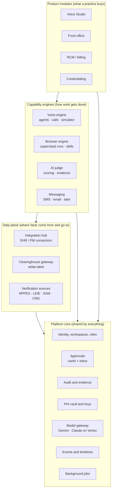

# CarePlix product architecture: independent modules

Owner: Head of Solution Design and Product Innovation · 4 Nov 2026 · Status: **approved direction**

CarePlix is a set of independent modules that a practice can switch on one at a time:
- **Voice Studio**
- **Front office**
- **RCM**
- **Credentialing**
- **Browser agent**

They share one platform core. Each module owns its data and screens, talks to others only through
published interfaces, and can be sold, enabled, tested and later deployed on its own.

## 1. Layers

**Dependency rule:** arrows point down only. A product module may use engines, the data plane and the core,
but never another product module's tables or internals. Engines never know which product called them.

## 2. The modules

| Module | Owns (data) | Offers (interface) | Uses | Deployable today |
|---|---|---|---|---|
| **Platform core** | workspaces, users, memberships, audit events, approvals, model settings, keys | auth and roles, `audit()`, `approvals.request/decide`, `models.client()`, events, jobs | — | in the API service |
| **Voice engine** | agents and versions, call attempts, call events, transcripts, findings, tool executions | start a call, simulate, rehearse; tools; timeline; scorecard data | core, hub (tools) | API + **voice worker** (separate service) |
| **Browser engine** | browser runs, steps (approval cards), site settings, saved sessions, skills (next) | start a supervised run, approve and deny steps, take over; later skills as tools | core (approvals, model gateway, vault) | API + **browser runtime** (separate service) |
| **AI judge** | judgements per run | `judge(run)`: verdict, score, per-check evidence | core (model gateway) | in the API |
| **Integration hub** | connections, synced mirror, sync cursors, webhook events, write intents | read patients, appointments and billing data; propose writes (approved) | core | API + webhooks service |
| **Clearinghouse gateway** | payer directory, enrollments, transactions | eligibility, claim status, claims, ERA (white-labelled) | core, hub | in the API |
| **Voice Studio** (product) | scenarios, suites (next) | scenarios, simulate and live runs, scorecards and judge results, publish gate | voice engine, AI judge | in the API + Studio UI |
| **Front office** (product) | eligibility checks, backfill openings and offers, front-desk messages | receptionist, eligibility autopilot, backfill | voice engine, hub, clearinghouse | in the API |
| **RCM** (product) | claims, denials, appeals, balances (RC milestones) | claim lifecycle and work queues | clearinghouse, hub, voice, browser | planned |
| **Credentialing** (product) | provider records, documents, verifications, enrollments, privileges | provider readiness, monitoring, packets | verification sources, voice, browser, judge | planned |

## 3. Rules that keep modules independent

1. **Own your tables.** Each module's tables carry its prefix, for example `browser_runs` and `cred_providers`. Every
   row carries `workspace_id`. No module reads or writes another module's tables; it calls that module's
   service functions, or reacts to its events.
2. **One package per module.** API code lives in its own package:
   - existing: `careplix_api/connect`, `practice`, `integrations`;
   - new: `careplix_api/browser` and `careplix_api/judge`;
   - later: `careplix_api/credentialing`.

   Each package has a `service.py` (interface), its models, and its router under `/api/<module>`.
3. **Contracts are explicit.** Payloads that cross a module or service boundary have JSON schemas in
   `packages/contracts`: tool definitions, event envelopes, outcomes, and later browser actions.
4. **Shared things live in the core, once.**
   - **Approvals:** one card format and one inbox for browser steps, write intents and clearinghouse
     submissions.
   - **Audit**, the **PHI vault** and the **model gateway**: no module calls Vertex with its own credentials
     path.
5. **Modules are switched on per workspace.** A workspace lists its enabled modules. Routes, navigation and
   background jobs check the flag, so a practice that buys only Credentialing sees only Credentialing.
6. **Separate runtimes where the load is different.**
   - **Voice worker** (real-time audio) and **browser runtime** (Chromium) already run as their own services.
   - **Webhooks** run as their own public service.
   - Everything else is a **modular monolith** in the API: one deploy, clear seams. A module is extracted into
     its own service only when its scale or security needs differ, and the package boundary makes that a
     move, not a rewrite.
7. **Engines are product-agnostic.**
   - The browser engine runs "a supervised task on a site". It does not know about claims or credentials.
   - Products bring the task, the inputs and what to do with the result.
   - The same holds for voice (a scenario or task) and the judge (a goal, checks, limits and a record).

## 4. How a cross-module flow looks

**Example: a credentialing follow-up.**
1. Credentialing finds an enrollment stuck "in review".
2. It asks the **voice engine** to call the payer, using scenario CR1.
3. The **AI judge** scores the call against the scenario's checks.
4. The judge's verdict and the reference number go back to Credentialing as a result.
5. If the payer says "check the portal", Credentialing asks the **browser engine** for a supervised run.
6. Each step needing approval appears in the **Approvals inbox**.
7. The result is again returned to Credentialing. Every step is in the **audit** trail.

## 5. Where the code is today, and what moves

| Today | Module | Action |
|---|---|---|
| `agents_service.py`, `calls_service.py`, `livekit_gateway.py`, `tools_service.py`, `apps/worker` | Voice engine | Stay; group under `careplix_api/voice/` when next touched |
| `scenarios.py`, `scenarios_api.py`, `scenario_library.py` | Voice Studio | Group under `careplix_api/voice_studio/` when next touched |
| `connect/`, `integrations/`, `practice/` (sync, intents, webhooks) | Integration hub | Stay |
| `practice/eligibility.py`, `backfill.py`, `receptionist.py` | Front office | Move to `careplix_api/front_office/` with RC1 |
| `integrations/stedi.py` | Clearinghouse gateway | Becomes `careplix_api/clearinghouse/` in RC1 (white-label) |
| new | AI judge | `careplix_api/judge/` (VS3) |
| new | Browser engine | `careplix_api/browser/` + `apps/browser` runtime service |
| new | Approvals (core) | Starts inside the browser engine with a generic card shape; promoted to `careplix_api/approvals/` when write intents join the inbox |
| new | Credentialing | `careplix_api/credentialing/` (CR-0) |

Moves are pure refactors, done in their own pull requests with no behaviour change, so they never mix with features.
